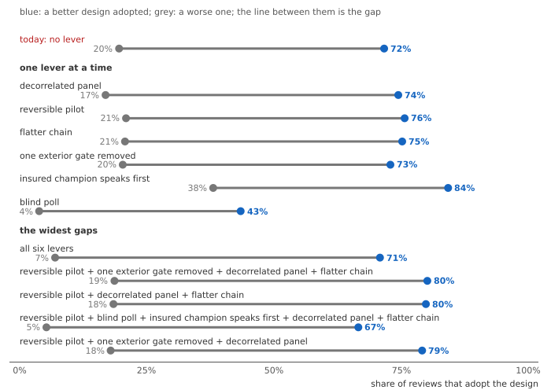
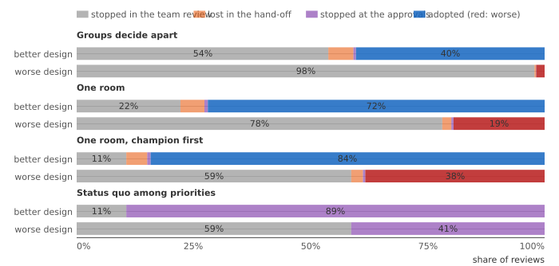

# Part 1: Correct, and Rejected

Companion to [Correct, and Rejected](https://e-mindset.space/blog/adoption-mechanics-part1-correct-and-rejected/).
The post states the argument; this page shows where each number comes from and how to change the inputs.
Layer tags follow the blog: **Bound** (proof or source), **Fit** (reading or approximation), **Estimate**
(simulation or measurement).

## The question

A research group brings a successor design that is better than the incumbent, and the organization reviewing
it is competent and acts in good faith. Which mechanisms reject it anyway, how much does each one cost on
better and worse designs, and in what order should they be switched off?

## The belief

A correct design that is argued well enough will be adopted, and when it is not, someone behaved badly:
politics, ego, inertia. The belief makes rejection a failure of character, so the remedy it offers is a better
argument or better people.

## The mechanism, as the code runs it

The running case is one review: 15 members in 3 reporting layers and 4 approvers with a veto (architecture board,
engineering manager, security, product); site reliability's release check comes after the decision and is not
modeled. [`model/pipeline.py`](../model/pipeline.py) composes four stages, and every run is made on a
better design and on a worse one, whose champion still argues for it.

- **Sensors.** Each member's signal about the design is right with probability 0.7, and members' errors
  correlate at 0.25 through one shared factor ([`model/sensors.py`](../model/sensors.py)).
- **Aggregation.** Members vote in order, each following the lead once it outweighs their own signal
  ([`model/cascades.py`](../model/cascades.py)). The champion speaks first or stays silent; a blind poll
  replaces the sequence when that lever is applied. Who speaks at all is the career plane of
  [`model/career.py`](../model/career.py), whose endorsement term is signed by the direction of the dissent.
- **Hand-off.** The verdict's margin crosses 3 layers, each keeping 0.85 of its amplitude.
- **Actuator.** The spatial test: every gate must prefer the design to the status quo in a plane of concerns
  ([`model/actuator.py`](../model/actuator.py)). Then the evidence test: the relayed evidence plus each gate's
  noise must clear the adopt threshold of a hysteresis band set by a switching cost of 0.2 and loss aversion of
  2.25, which can weight trailing periods or the cost of leaving the status quo.

- **Groups that decide apart.** `group_review` holds the review in groups with their own share of the
  evidence (a pilot team at precision 0.8, two groups at 0.65) and a frame local to each room; a design any group
  does not favor stops there. With `carry`, each group hears the earlier groups' conclusions first.
- **Where designs die.** `stage_fates` records where each review ends: the team review, the hand-off (the
  unweakened verdict would have convinced every approver, the relayed one does not), the approvals, or adopted.
  `review_traces` keeps every draw of those same reviews, vote by vote, for the figure that replays them (T26, T28).
- **The agenda setter.** `setter_proposal` gives the change a gate proposes when it sets the agenda: the point of
  the win-set closest to its priorities, which lies in the approvers' hull, so one compromise ends change (T5).
- **Too many conversations.** `window_survival` (pairwise disagreements settled one at a time within a 13-week
  window), carried conclusions in `group_review`, `veto_crowding` (extra groups holding a veto) and `bikeshed`
  (the law of triviality: a design split into simple pieces draws opinions from everyone) give the four deaths
  without a no (T27).

The write-back loop of [`model/writeback.py`](../model/writeback.py) runs apart from the review: it learns
what drives outcomes from the reasons people record. Each adoption probability comes from 20,000 simulated
reviews, so its standard error is at most 0.0035 (T9).

## The laws

- **Bound. Definition 1.** The member: a bounded binary signal, an action in order, and a payoff of accuracy,
  immediate conformity, reputation over a horizon, loss aversion at the status quo and a career position, with
  instability and the faithfulness of stated reasons. People and agents differ only in the values.
- **Bound. Definition 2.** Adoption is the spatial test, 0 or 1, times the probability that the relayed
  evidence clears every threshold; only the spatial test multiplies the rest.
- **Bound. Definition 3.** A review's operating point: its probabilities of adopting a better and a worse
  design; the achievable region and its frontier (T18).
- **Bound. Proposition 1.** The majority floor of a correlated panel (T2), Vasicek's limit, stated for a panel
  by Li and Hai.
- **Bound. Proposition 2.** The share of runs that end in a wrong cascade with binary signals of precision q,
  (1 - q)^2 / (1 - 2q(1 - q)) (T3), from the model of Bikhchandani, Hirshleifer and Welch.
- **Bound. Proposition 3.** The veto cliff and absorption with Euclidean preferences (T5), Tsebelis's win-set;
  with other strictly convex preferences the cliff is the gates' Pareto set.
- **Bound. Proposition 4.** The limit of learning from stated reasons as causes, the faithfulness below which
  it has the wrong sign, and the non-identification that keeps any test on the records alone from finding it
  (T7; writeback.reason_moments).
- **Fit.** The hysteresis band's growth with the switching cost (T6), quoted as a trend between two cadences.

## The results

| What | Value | Section |
|---|---|---|
| Independent opinions in 15 members at correlation 0.25: scores; votes | 3.333; 4.842 | T1 |
| Majority floor at error 0.30, correlation 0.25 | 0.1471 | T2 |
| Wrong cascades at precision 0.7: myopic, probing 1.0 | 0.1560, 0.0703 | T3 |
| Endorsed senior: dissent for the successor; in the incumbent's defence | -0.530; +2.170 | T4 |
| Adoption threshold at cost 0.2: loss on trailing periods; loss on the switch | 0.1771; 0.2681 | T6 |
| Reviews of a better design ending in the team review: groups apart, one room | 0.5378, 0.2217 | T26 |
| Decides within a quarter at a week per pair: 5, 6, 7 groups | 0.8342, 0.3249, 0.0250 | T27 |
| Design passes every approver with 1, 2, 4, 6 extra vetoes | 0.5613, 0.3115, 0.0950, 0.0270 | T27 |
| Law of triviality, design passes whole, in 2, 4, 8 pieces | 0.7387, 0.3527, 0.0003, 0.0000 | T27 |
| Adoption threshold at cost 0.2 against the Marshallian trigger, at steps 1.0, 0.1 and 0.03 | 17.4, 9.0, 5.1 times | T6 |
| Two and five partitioned groups diverge, 0.12 of the correlation local to each | 0.2997, 0.6629 | T10 |
| Mean net endorsement share the gates read: sequence, blind poll | 0.5308, 0.4006 | T10 |
| Naive belief at faithfulness 0.26 | -0.3389 | T7 |
| Interaction of an early silence with cascades | +0.0303 to +0.1521 | T8 |
| Gap alone: poll, champion; together | 0.3962, 0.4619; 0.4186 | T16 |
| All six levers: better and worse design | 0.7085 and 0.0698 | T18 |
| Region under six alternative settings: widest gap always includes decorrelation | see rows | T20 |
| The energy bill of the meeting, settlements whole and in 2, 4, 8 pieces | 4.20, 23.76, 134.40, 758.10 | T39 |

*What the review can reach. Each point is one of the 64 combinations of the six levers; the blue ones are the 21 that no other combination beats on both counts, and all but one of them include a decorrelated panel. Today's review sits inside the frontier. All six levers together, the widest gap, keep a better design's chances near where they were and cut a worse design's from 20% to 7%. With the status quo inside the gates' hull, every combination sits at the origin.*

The post's step-through of the gates draws the ideal points, status quo positions and gate removal printed by
T5.

## Calibration

The sensors and the aggregation stage are calibrated against scientific peer review, the closest public analogue
(T22, [`model/calibration.py`](../model/calibration.py)). Journal peer review's mean reliability, 0.34, implies a
reviewer right 70% of the time. The NeurIPS consistency experiments, in which two committees reviewed the same
papers, imply a shared within-committee error that gives a latent error correlation of 0.23 to 0.32. The model
reproduces the observation of Pier and coauthors that discussion raises agreement within panels and lowers it
between them. T23 reruns the running case with the field corrections (sharper rejection, negativity bias); the
conclusions hold. The hand-off and the gates remain illustrative.

## The bill, and when the advice reverses

- **Sensors.** The widest gap needs the decorrelated panel in every setting tried, and all but one frontier point includes it.
- **Aggregation.** A champion speaking first into a sequence raises adoption of a worse design from 20% to 38%.
- **Hand-off.** From a candor of 0.95 to 0.75, adoption of a better design falls from 76% to 54%.
- **Conversations.** Seven groups decide within a quarter under 3% of the time, and a design split into four simple pieces almost never passes.
- **Actuator.** Zero adoptions inside the hull, under every combination of the other levers.
- **Write-back.** A belief of -0.34 about a driver of +1, at a faithfulness of 0.26.

**When the advice reverses.** The advice of this post is to read a review as a pipeline, check the gates first, and choose levers on both kinds of design. It reverses for a review with a single decider and no gates, where the actuator is the verdict itself and the stages that read evidence are all that remain.

## What you can vary

Every constant of the running case is a field of `Committee` in [`model/pipeline.py`](../model/pipeline.py),
and T10 sweeps six of them one at a time, on a better and a worse design. The career plane's two constants are
swept in T4. The levers of the region are listed in `FRONTIER_LEVERS` in `sections/post2.py`. Change a value,
run `python3 reproduce.py T18`, and compare with the frozen output.
