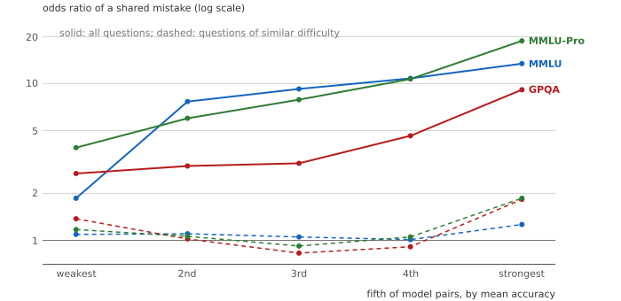
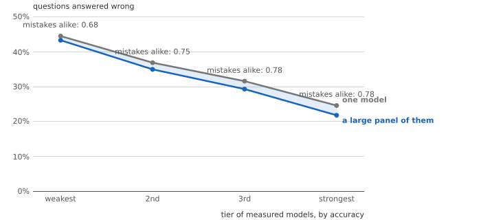

# Part 2: Smarter Agents, Fewer Opinions

Companion to [Smarter Agents, Fewer Opinions](https://e-mindset.space/blog/adoption-mechanics-part2-smarter-agents-fewer-opinions/).
The post states the argument; this page shows where each number comes from and how to change the inputs.
Layer tags follow the blog: **Bound** (proof or source), **Fit** (reading or approximation), **Estimate**
(simulation or measurement).

## The question

When the reviewers are AI agents, or a mix of agents and people, which stages of the same pipeline change?
How dependent are strong models' errors, and how much of that is shared difficulty? When do agents help a
panel of people, and when can upgrading every member make the panel worse?

## The belief

Agents have no careers, no ego and no sunk endorsements, so a panel of them should be free of the politics
that stalls people, and a panel of better models should be a better panel.

## The mechanism, as the code runs it

The member model is Part 1's with agent values. Dependence is measured, not assumed.
[`data/fetch_helm.py`](../data/fetch_helm.py) read Stanford HELM's per-question results for three benchmarks:
HELM Lite MMLU (95 models, 567 questions), HELM Capabilities GPQA (65 models, 446 questions) and MMLU-Pro
(64 models, 1,000 questions; one model whose results file the bucket does not serve is skipped). It stored
only counts: per pair of models, right and wrong answers overall and within 5 and 10 strata of question
difficulty, where difficulty is how many of the other models answered each question right.
[`model/correlation.py`](../model/correlation.py) turns the counts into a latent (tetrachoric) correlation, the
correlation of the right/wrong indicators, and the Mantel-Haenszel odds ratio within strata with its
Robins-Breslow-Greenland standard error. A tetrachoric correlation per stratum is not used: half the strata of
the strongest pairs hold three or fewer questions both models got wrong, and it fails there.
[`model/upgrade.py`](../model/upgrade.py) evaluates the upgrade condition and the critical elasticity,
[`model/hybrid.py`](../model/hybrid.py) runs mixed panels on both states of the local fact, with agents whose
answers can carry part of it, and [`model/cascades.py`](../model/cascades.py) runs cascades among peers whose
signals correlate.

## The laws

- **Bound. Definition 4.** An upgrade path: panels whose members' error and correlation change together, with
  the margin of each step.
- **Bound. Proposition 5.** Along an upgrade path a large panel improves if and only if the margin is positive
  (T11). It follows from Proposition 1.
- **Bound. Corollary 1.** A small upgrade improves a large panel if and only if the elasticity of correlation
  with respect to error is below 2p/(abs(z) phi(z)), which falls toward zero as members improve (T11, T12).
- **Bound. Proposition 6.** Common-mode dilution: in a large panel pooled without weights by a threshold at the share
  expected when the successor is worse, agents that share a blind spot set the chance of adopting a worse design,
  Phi(Phi^-1(y0)(1 - sqrt(1 - rho))/sqrt(rho)), whatever the people know; the gap the people can open shrinks as rho
  grows. `dilution_limit` and `dilution_bound` in [`model/hybrid.py`](../model/hybrid.py) compute it (T38).
- **Bound.** The spatial gate: with the status quo inside the gates' hull every other lever is worth nothing
  (T16).
- **Estimate.** Pooled and within-difficulty dependence on three benchmarks and the opinions in a vote (T12,
  T13, T19); cascades against a blind vote and the floor, under three probing weights (T14); mixed panels on
  both states (T15) and with informative agents (T17); single levers and the poll-and-champion pair (T16).

## The results

| What | Value | Section |
|---|---|---|
| Synthetic path: floor rises while each member improves | 0.0486 to 0.0774 | T11 |
| Pooled odds ratio, strongest fifth: MMLU, GPQA, MMLU-Pro | 13.38, 9.11, 18.73 | T13, T19 |
| Within-difficulty odds ratio, strongest fifth | 1.25, 1.81, 1.84 | T13, T19 |
| Within-difficulty odds ratio, middle three fifths, all benchmarks | 0.82 to 1.09 | T13, T19 |
| Opinions in a vote, strongest fifth | 1.96, 2.23, 1.93 | T13, T19 |
| Strongest tier: floor and member error; last upgrade's elasticity and critical value | 0.2172, 0.2451; 0.02, 2.81 | T12 |
| Latent correlation 0.75: wrong cascades myopic, blind majority of 30, floor | 0.2823, 0.2820, 0.2724 | T14 |
| Five people, agent correlation 0.6: surprisingly popular, people alone (A+ and A-) | 0.5489/0.4086, 0.5310/0.0145 | T15 |
| Herding at latent correlation 0.75, hard and misleading questions: sequence against blind | 0.2584/0.1513, 0.7192/0.8812 | T24 |
| Item-response null, strongest fifth (mean of 20 seeds): MMLU, GPQA, MMLU-Pro | 1.16, 1.17, 1.36 | T25 |
| Agents help: midpoint gap past the people's 0.5165 at agent information | 0.2 to 0.3 (rho 0.3), 0.3 to 0.4 (rho 0.6) | T17 |
| Dilution limit at a quarter of a person per agent, rho 0.6 (A+/A-), against 20 agents and 5 people | 0.5041/0.4017, 0.5020/0.4014 | T38 |
| Twenty agents voting in the meeting, settlements per piece whole and in four pieces (15 people alone) | 23.80, 190.40 (4.20, 33.60) | T39 |

*What stronger models share (T13, T19). The better two models are, the likelier they make the same mistake: for the strongest fifth of pairs the odds are 13, 9 and 19 times those of independent errors on three benchmarks. Compared on questions of similar difficulty, the grey lines, most of that disappears: hard questions are hard for every model. What remains for the strongest pairs, 1.2 to 1.8 times, is blind spots of their own.*

*Where an upgrade takes a panel (T12). Stronger models are wrong less often, and so is a large panel of them: every measured upgrade lowered both. The shaded gap is all that voting buys, and it stays thin, because the models' mistakes grow more alike as they improve, from 0.68 to 0.78. A large panel of the strongest tier is wrong on 22% of questions, one of its models on 25%.*

## The bill, and when the advice reverses

- **Sensors, for agents.** An average of the strongest models' votes holds about two independent opinions, and voting removes about a tenth of their error.
- **Aggregation, for agents.** Five partly informed people inside a panel of twenty blind-spotted agents adopt a worse design 41% of the time under the surprisingly-popular rule, and 1% deciding alone.
- **Hand-off and actuator, for agents.** Zero adoptions under every lever on sensing, aggregation or hand-off while the status quo sits inside the hull.

**When the advice reverses.** The advice of this post is to measure a panel's dependence, pooled and within difficulty, before trusting its votes, and to let the people who hold local facts decide on them. It reverses for questions whose answers are well covered by shared training data, where the strongest single model is already the best panel and people add only noise.

## What you can vary

The tiers in T12 are equal-sized splits of the models above half accuracy; change the split in
`sections/post2.py`. The number of difficulty strata is chosen by the key ('5' or '10') passed to `_pairs`.
The panel sizes, the agents' error, correlation and information in T15 and T17 are arguments of `panel_run`.
The data files hold counts only, so any other split can be computed without refetching.
