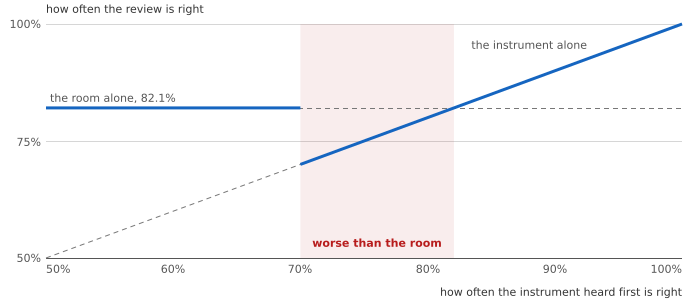
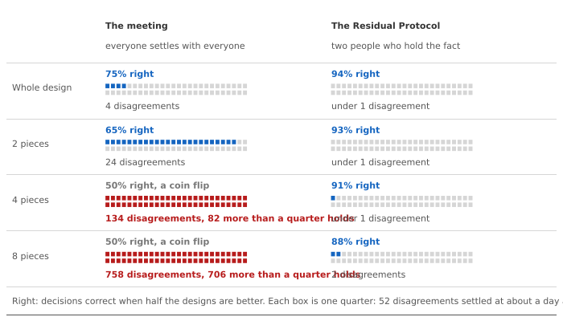
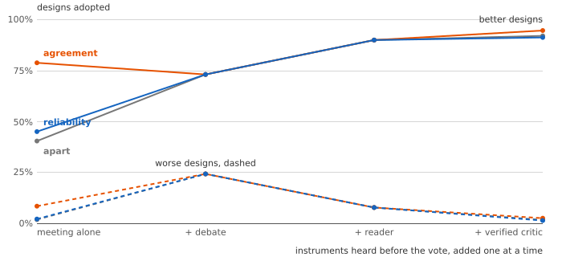
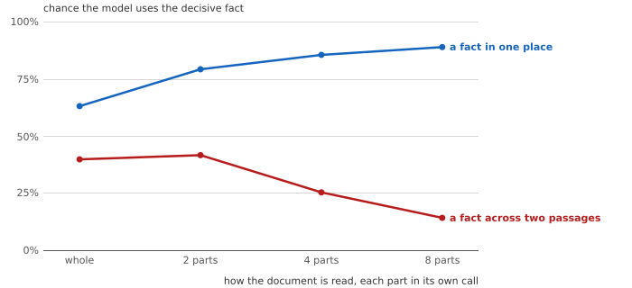

# Part 3: The Machine Gets the First Word

Companion to [The Machine Gets the First Word](https://e-mindset.space/blog/adoption-mechanics-part3-the-machine-gets-the-first-word/).
The post states the argument; this page shows where each number comes from and how to change the inputs.
Layer tags follow the blog: **Bound** (proof or source), **Fit** (reading or approximation), **Estimate**
(simulation or measurement).

## The question

Three AI tools are entering design reviews: long-context models handed the whole design, mediators that build
agreement between groups, and critics or debates that supply dissent, while the reviewer's own role shifts from
producing work to checking a machine's. Where in the review pipeline does each tool help, where does it repeat a
failure the first two parts found, and how should a fixed budget of human attention be spent once Part 1's levers
have run out?

## The belief

AI fixes the meeting: a model reads the whole design, a mediator finds common ground, and a critic supplies the
dissent people withhold.

## The mechanism, as the code runs it

[`model/instruments.py`](../model/instruments.py) gives a model's recall of a fact by its relative position in a
document and by how much of the model's effective window the document fills (Definition 7). The shape follows the
published measurements: a U-shaped curve, and near the window the advantage of the beginning fades while the
advantage of the end stays. Its constants are swept (T29) and fitted: `fit_recall` fits the curve to the
accuracy-by-position tables of Liu et al. (2024), transcribed with their source in
[`data/liu2024_positions.json`](../data/liu2024_positions.json), and `document_use` measures each reading as the
share of the gain over answering without the document (T32). A document read in parts is read in separate calls with an
overlap of a quarter; a relational fact needs both of its positions in one part.

[`model/pipeline.py`](../model/pipeline.py) carries the other two tools. `pooled_review` is the difference
mediator of Definition 8: every member judges blind, and the judgments are pooled equally or by the log-odds of
each group's precision. The agreement mediator is `group_review` with carried conclusions, as in Part 1. A
`Committee` with `debate` set hears a shared verdict of that accuracy before acting, as a public lead of its
log-odds in signals, or after acting with `debate_after`, as one weighted input to the tally; `advocate_lead` is a
single advocate's public lead toward the design whatever its merit. The lead is recounted in each group's own signals before the
lock test, so a member follows an input only when its log-odds outweigh their own by more than the probing weight
(Proposition 7).

[`model/energy.py`](../model/energy.py) counts the human energy of a review (Proposition 8): `review_energy` computes,
exactly, the meeting's mesh of settlements, the Residual Protocol's star against the machines' reference, and the
machine heard first, by summing over the binomial holder counts and convolving the settlements across pieces;
`settle_in_time` in `model/pipeline.py` is the window's Erlang survival, shared with Part 1's triviality. The
protocol `'protocol'` adds the Residual Protocol's routing and list: `route` holders answer each listed piece (T41),
the machines list each piece with chance `lists` whatever it hides, and holders of the fact add a missed flaw with
chance `adds` (T42). `amend_to_win_set` in [`model/actuator.py`](../model/actuator.py) finds the nearest version of
a design that every gate strictly prefers to the status quo (T43). T40 sweeps a `Committee`'s precision and
correlation at the corner of Part 1's six levers.

Instruments that share a source are `SharedInput`s of a `Committee`, each with its accuracy, its timing and a
`source`. Inputs of one source err through a latent score with correlation `family_rho`, inputs of different
sources through one with `cross_rho`, and inputs with no source independently, as a check against the running
system does (T35, T36). Members weigh every input by its accuracy as if the inputs were independent.

## The laws

- **Fit. Definition 5, the Residual Protocol.** The post's framework: budget, exhaust, route, probe, diff, carry, own.
  Machines settle what can be written and list what they cannot; each listed or added question goes to the holders
  of its fact, who answer alone with evidence of their own; only departures that could change the decision are
  settled; the decision is carried as recorded, and every answer has a named owner. Its departure rate is the health
  gauge (F21).
- **Bound. Definition 6 and Corollary 2.** Instruments from one source (one model, however prompted) err together;
  roles of one source heard first err, as their number grows, at Proposition 1's floor for that source. An
  instrument grounded in a check against the system (tests, telemetry, static analysis), whoever runs it, errs
  through the check's coverage instead.
- **Bound. Definition 7.** Positional recall, and reading in overlapping parts.
- **Bound. Proposition 7.** A shared input heard first captures every member once its log-odds exceed one member's by
  more than the probing weight, and then lowers accuracy if and only if it is less accurate than the panel's own
  majority. With members right 0.7 of the time and a majority error of 0.1793 (T37), the band runs from 0.7 to 0.8207.
- **Bound. Definition 8.** The agreement and difference mediators.
- **Bound. Corollary 3.** Once shared inputs heard first capture every member, neither the combining rule nor the
  order of speaking changes the verdict. Below capture, a blind vote ignores them and a sequence takes them as a head
  start of their log-odds in signals. With groups of unequal precision an input can capture some groups and not
  others; the members compare its log-odds with their own, so a group sharper than the input keeps its judgment.
- **Bound. Proposition 8.** Mesh and star: settling every pair of a piece's opinion holders costs C(n,2) s^2
  settlements in expectation, settling only departures from a reference n s d; the star is cheaper exactly when
  d < (n - 1) s / 2, and deciding in time has probability at least 1 - expected owner-weeks / window.
- **Estimate. Combining runs out (T40).** At the corner of Part 1's six levers, precision moves the review more than
  correlation; a shared briefing that raises both keeps part of the gain, less as correlation rises (Proposition 5
  applied to people). Carrying the verdict unweakened and quieter gates add to it.
- **Estimate. Routing and the blind-spot list (T41, T42).** Routed to holders of the fact, the protocol keeps worse
  designs about as rare as the unrouted protocol at a fraction of its settlements; routed at random it does not. A
  list blind to the flaw leaves the outcome to the questions holders add.
- **Estimate. Amending into the win-set (T43).** Where a design fails late gates as it stands, the nearest version
  every gate prefers usually exists and keeps part of the design's advance, less as gates are added.
- **Estimate. The binding constraint (T39).** One step of each budget at four operating points, in the manner of the
  Constraint Sequence Framework: verification binds first, then the number of eyes on each piece, then grounded checks.
- **Estimate. The unrouted protocol, computed (T39).** The review of a design whole or in 2, 4 or 8 pieces under the
  meeting, the unrouted protocol and the machine heard first, exactly; F20 tests what the computation cannot reach.
- **Fit. F20 to F23.** The residual surfaces unwritten facts, the departure rate shows capture, probes sharpen without
  aligning, and holders find what the machines' list misses.
- **Estimate.** Reading whole and in parts, local and relational facts, swept (T29) and calibrated on six measured
  models (T32); agreement and difference mediation by speaking order, the window and triviality with faster settling
  (T30); debate before and after the vote, and single advocates (T31); critics and tuning (T33); the region of
  instruments (T34); instruments that share a source (T35); roles stacked against the floor and an evidence channel
  (T36); the exact majority error that sets the upper edge of the capture band (T37).

## The results

| What | Value | Section |
|---|---|---|
| Local fact, full window: whole, four parts | 0.6302, 0.8544 | T29 |
| Relational fact, quarter window: whole, four parts, eight parts | 0.7061, 0.2878, 0.1507 | T29 |
| Carried conclusions, team at 0.9 first and last (A+/A-) | 0.9002/0.0266, 0.5203/0.2714 | T30 |
| Pooled by reliability, team at 0.9 first, second, last (A+) | 0.6313, 0.6696, 0.6695 | T30 |
| Groups deciding apart, team at 0.9 first, second, last (A+) | 0.3706, 0.3377, 0.3393 | T30 |
| Six groups in the window, settling 1 and 0.5 weeks | 0.3249, 0.9924 | T30 |
| Four simple pieces, settling 0.25 and 0.0625 weeks | 0.0003, 0.0302 | T30 |
| Blind vote, no debate (A+/A-) | 0.4346/0.0384 | T31 |
| Debate heard first, accuracy 0.75 and 0.9 (A+/A-) | 0.7310/0.2394, 0.8825/0.0975 | T31 |
| Single advocate, lead 2 (A+ and A-) | 0.9722 | T31 |
| Calibrated, local fact: whole, four parts (range over six models) | 0.0643 to 0.4392, 0.4627 to 0.7639 | T32 |
| Calibrated, relational fact: highest in any arrangement | 0.1937 | T32 |
| Critic heard first, none and 0.9 of false flags verified (A+/A-) | 0.6790/0.1401, 0.9438/0.1401 | T33 |
| Region, no instruments; parts with verified critic and debate first (A+/A-) | 0.4032/0.0180; 0.9297 to 0.9449 / 0.0169 to 0.0249 | T34 |
| Debate first alone, partial capture: apart, agreement, reliability (A+/A-) | 0.6548/0.0559, 0.7994/0.0872, 0.6112/0.0457 | T34 |
| Roles right 0.75, within-source 0.6: 9 and 41 roles wrong, floor | 0.2034, 0.1961; 0.1919 | T36 |
| Leading instruments, worse adopted: independent, one family at 0.6 and 0.9 | 0.0199, 0.0454, 0.0640 | T35 |
| Energy, reviewed whole: meeting and unrouted protocol (A+/A-, settlements) | 0.7386/0.2351, 4.20; 0.9739/0.3116, 0.30 | T39 |
| Energy, four pieces: meeting and unrouted protocol (A+/A-, settlements) | 0.0001/0.0000, 134.40; 0.7866/0.0917, 3.39 | T39 |
| Six levers' corner; no correlation; precision 0.80 (A+/A-) | 0.7085/0.0698; 0.7294/0.0362; 0.8649/0.0187 | T40 |
| Shared briefing to precision 0.80 at correlation 0.10, 0.30, 0.50 (gap change) | +0.2074, +0.1341, +0.0748 | T40 |
| Unweakened verdict, quieter gates, both with precision 0.80 (A+/A-) | 0.7808/0.0811, 0.8256/0.0934, 0.9611/0.0260 | T40 |
| Four pieces: two random holders, two holders of the fact (A+/A-, settlements) | 0.9261/0.3422, 0.80; 0.9261/0.1013, 0.80 | T41 |
| Blind list: half listed; holders add three in four; every piece listed (A-) | 0.5380; 0.3305; 0.1013 | T42 |
| One and four late gates: passes as it stands, amendable, advance kept | 0.5655, 0.9810, 0.570; 0.0955, 0.8648, 0.391 | T43 |

*The region of instruments (T34). Every combination of reading, combining rule, debate and critic; the widest gaps combine a verified critic and a debate heard first, and the combining rule barely matters once they are there (Corollary 3).*

*Who speaks first (Proposition 7, T37). Heard first, an AI verdict is ignored until it is surer than one reviewer, then everyone copies it, and the review becomes exactly as good as the AI: worse than the room between 70% and 82.1%, better above. With answers recorded first, the room keeps its 82.1% whatever the AI.*

*What the review costs (Proposition 8, T41). Each dot is a disagreement someone must settle, and each box holds one quarter. Split a design, and the meeting must settle every pair of opinions until it overflows the quarter and stalls at a coin flip. The Residual Protocol asks only the people who hold the facts: a dot or two, and it stays right.*

*Instruments take over the meeting, one group at a time (T34). Without instruments the three ways of combining the groups move adoption of a better design from 40% to 79%. A debate heard first outweighs the two weaker groups but not the pilot team, so the rules still differ (Corollary 3 (ii)); the reader and the verified critic add evidence until it outweighs every member, and the rules converge on 93% to 94% against about 2% (Corollary 3 (i)).*

*Split the reading, not the design. A fact in one place is used more often when the model reads the design in parts; a fact that needs two distant passages goes the other way, because the passages rarely land in the same call (T29, dip depth 0.3).*

## The bill, and when the advice reverses

- **Reading, with a model.** Near a full window a whole reading uses a local fact 63% of the time and a pair of
  distant facts 40% of the time.
- **Combining, with a mediator.** With the best-informed group speaking last, carried conclusions adopt a worse
  design 27% of the time, against under 1% for weighted pooling.
- **Dissent, with a debate or a critic.** A persuasive single advocate captures the review, which then adopts better
  and worse designs alike, 97% of the time.
- **Human attention, routed.** In four pieces the meeting needs 134 settlements and almost never decides; routed to two
  holders of each fact, the protocol needs 0.8 and adopts 93% of better designs against 10% of worse ones.
- **Blind spots, with a machine's list.** Listing half the pieces at random leaves a worse design adopted 54% of the
  time; holders adding what the list missed carry the review.

**When the advice reverses.** The advice of this post is to read designs in parts with models, pool blind judgments
by reliability, and hear a debate first only when it beats the panel's majority. It reverses for a model whose recall
does not depend on position, for groups whose evidence is equal, where weighting changes nothing, and for a debate
measured as more accurate than the panel, which should speak first.

## What you can vary

The recall shape's base, dip depth and reach are arguments of `position_recall`, passed through `fact_detection`;
T29 sweeps the depth. The overlap of the parts is `OVERLAP` in `sections/post3.py`. The groups' evidence splits and
speaking orders are listed in T30, and any other split is a tuple of (members, precision) per group. The debate's
accuracy and timing, and the advocate's lead, are fields of `Committee`; so are the shared `inputs` and the
correlations `family_rho` and `cross_rho` that tie inputs of one source and of different sources.

The Residual Protocol's settings are arguments of `review_energy`: `route` for the holders of each piece, `catch` for
how often they hold its fact, `lists` and `adds` for the machines' list and the holders' additions (T41, T42). T40's
grid of precision and correlation is in `sections/post3.py`; any point is a `Committee` with the six levers set.
`amend_to_win_set` takes any design, status quo and set of ideal points (T43).
