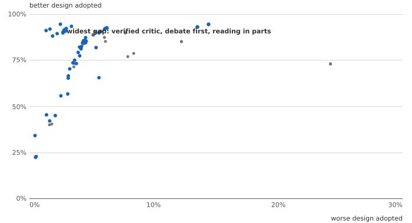

# Part 3: The Machine Gets the First Word

Companion to [The Machine Gets the First Word](https://e-mindset.space/blog/adoption-mechanics-part3-the-machine-gets-the-first-word/).
The post states the argument; this page shows where each number comes from and how to change the inputs.
Layer tags follow the blog: **Bound** (proof or source), **Fit** (reading or approximation), **Estimate**
(simulation or measurement).

## The question

Three AI tools are entering design reviews: long-context models handed the whole design, mediators that build
agreement between groups, and critics or debates that supply dissent. Where in the review pipeline does each help,
and where does it repeat a failure the first two parts found?

## The belief

AI fixes the meeting: a model reads the whole design, a mediator finds common ground, and a critic supplies the
dissent people withhold.

## The mechanism, as the code runs it

[`model/instruments.py`](../model/instruments.py) gives a model's recall of a fact by its relative position in a
document and by how much of the model's effective window the document fills (Definition 5). The shape follows the
published measurements: a U-shaped curve, and near the window the advantage of the beginning fades while the
advantage of the end stays. Its constants are swept (T29) and fitted: `fit_recall` fits the curve to the
accuracy-by-position tables of Liu et al. (2024), transcribed with their source in
[`data/liu2024_positions.json`](../data/liu2024_positions.json), and `document_use` measures each reading as the
share of the gain over answering without the document (T32). A document read in parts is read in separate calls with an
overlap of a quarter; a relational fact needs both of its positions in one part.

[`model/pipeline.py`](../model/pipeline.py) carries the other two tools. `pooled_review` is the difference
mediator of Definition 6: every member judges blind, and the judgments are pooled equally or by the log-odds of
each group's precision. The agreement mediator is `group_review` with carried conclusions, as in Part 1. A
`Committee` with `debate` set hears a shared verdict of that accuracy before acting, as a public lead of its
log-odds in signals, or after acting with `debate_after`, as one weighted input to the tally; `advocate_lead` is a
single advocate's public lead toward the design whatever its merit.

Instruments that share a source are `SharedInput`s of a `Committee`, each with its accuracy, its timing and a
`source`. Inputs of one source err through a latent score with correlation `family_rho`, inputs of different
sources through one with `cross_rho`, and inputs with no source independently, as a check against the running
system does (T35, T36). Members weigh every input by its accuracy as if the inputs were independent.

## The laws

- **Bound. Definition 5.** Positional recall, and reading in overlapping parts.
- **Bound. Definition 6.** The agreement and difference mediators.
- **Bound. Proposition 6.** A shared input heard first captures every member once its log-odds exceed one member's by
  more than the probing weight, and then lowers accuracy if and only if it is less accurate than the panel's own
  majority. With members right 0.7 of the time and a majority error of 0.1746 (T2), the band runs from 0.7 to 0.8254.
- **Bound. Corollary 2.** Once shared inputs heard first capture every member, neither the combining rule nor the
  order of speaking changes the verdict.
- **Bound. Definition 7 and Corollary 3.** Instruments from one source (one model, however prompted) err together;
  roles of one source heard first err, as their number grows, at Proposition 1's floor for that source. An
  instrument grounded in a check against the system (tests, telemetry, static analysis), whoever runs it, errs
  through the check's coverage instead.
- **Fit. A proposal, F20.** Review the residual: people read the whole design and judge alone first, the models'
  consensus is a reference rather than a voice, and the meeting is spent on departures from it.
- **Estimate.** Reading whole and in parts, local and relational facts, swept (T29) and calibrated on six measured
  models (T32); agreement and difference mediation by speaking order, the window and triviality with faster settling
  (T30); debate before and after the vote, and single advocates (T31); critics and tuning (T33); the region of
  instruments (T34); instruments that share a source (T35); roles stacked against the floor and an evidence channel
  (T36).

## The results

| What | Value | Section |
|---|---|---|
| Local fact, full window: whole, four parts | 0.6302, 0.8544 | T29 |
| Relational fact, quarter window: whole, four parts, eight parts | 0.7061, 0.2878, 0.1507 | T29 |
| Carried conclusions, team at 0.9 first and last (A+/A-) | 0.9002/0.0266, 0.5203/0.2714 | T30 |
| Pooled by reliability, team at 0.9 first, second, last (A+) | 0.6313, 0.6696, 0.6695 | T30 |
| Groups deciding apart, team at 0.9 first, second, last (A+) | 0.3706, 0.3377, 0.3393 | T30 |
| Six groups in the window, settling 1 and 0.5 weeks | 0.3249, 0.9924 | T30 |
| Four simple pieces, settling 0.25 and 0.0625 weeks | 0.0003, 0.0302 | T30 |
| Blind vote, no debate (A+/A-) | 0.4346/0.0384 | T31 |
| Debate heard first, accuracy 0.75 and 0.9 (A+/A-) | 0.7310/0.2394, 0.8825/0.0975 | T31 |
| Single advocate, lead 2 (A+ and A-) | 0.9722 | T31 |
| Calibrated, local fact: whole, four parts (range over six models) | 0.0643 to 0.4392, 0.4627 to 0.7639 | T32 |
| Calibrated, relational fact: highest in any arrangement | 0.1937 | T32 |
| Critic heard first, none and 0.9 of false flags verified (A+/A-) | 0.6790/0.1401, 0.9438/0.1401 | T33 |
| Region, no instruments; parts with verified critic and debate first (A+/A-) | 0.4032/0.0180; 0.9109 to 0.9449 / 0.0134 to 0.0249 | T34 |
| Roles right 0.75, within-source 0.6: 9 and 41 roles wrong, floor | 0.2034, 0.1961; 0.1919 | T36 |
| Leading instruments, worse adopted: independent, one family at 0.6 and 0.9 | 0.0165, 0.0423, 0.0632 | T35 |

*The region of instruments (T34). Every combination of reading, combining rule, debate and critic; the widest gaps combine a verified critic and a debate heard first, and the combining rule barely matters once they are there (Corollary 2).*

*Split the reading, not the design. A fact in one place is used more often when the model reads the design in parts; a fact that needs two distant passages goes the other way, because the passages rarely land in the same call (T29, dip depth 0.3).*

## The bill, and when the advice reverses

- **Reading, with a model.** Near a full window a whole reading uses a local fact 63% of the time and a pair of
  distant facts 40% of the time.
- **Combining, with a mediator.** With the best-informed group speaking last, carried conclusions adopt a worse
  design 27% of the time, against under 1% for weighted pooling.
- **Dissent, with a debate or a critic.** A persuasive single advocate captures the review, which then adopts better
  and worse designs alike, 97% of the time.

**When the advice reverses.** The advice of this post is to read designs in parts with models, pool blind judgments
by reliability, and hear a debate first only when it beats the panel's majority. It reverses for a model whose recall
does not depend on position, for groups whose evidence is equal, where weighting changes nothing, and for a debate
measured as more accurate than the panel, which should speak first.

## What you can vary

The recall shape's base, dip depth and reach are arguments of `position_recall`, passed through `fact_detection`;
T29 sweeps the depth. The overlap of the parts is `OVERLAP` in `sections/post3.py`. The groups' evidence splits and
speaking orders are listed in T30, and any other split is a tuple of (members, precision) per group. The debate's
accuracy and timing, and the advocate's lead, are fields of `Committee`; so are the shared `inputs` and the
correlations `family_rho` and `cross_rho` that tie inputs of one source and of different sources.
