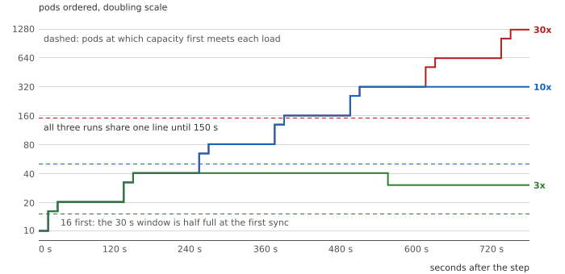

# Capacity in Arrears

**The code and data behind the blog series
[Capacity in Arrears: Autoscaling Under Dead Time, Saturated Metrics, and Retry Debt](https://e-mindset.space/blog/capacity-in-arrears-part1-one-bit-per-dead-time/)
on [e-mindset.space](https://e-mindset.space).**

An autoscaler adds capacity for the load it can measure, and an overload is the load it
cannot. The series takes the Kubernetes Horizontal Pod Autoscaler (v1.34.0) and KEDA (2.19),
reads what they actually compute, and derives what that costs during the minutes a new pod
takes to start. This folder holds everything the series' numbers come from. At its core is a Python port
of the autoscaler's replica calculation, with the simulations built on it and their frozen
output. The figures are drawn from that output, and a kit tests the predictions on a real
cluster.

| Part | Post | What it finds | Here |
|---|---|---|---|
| 1 | [One Bit per Dead Time](https://e-mindset.space/blog/capacity-in-arrears-part1-one-bit-per-dead-time/) | A saturated CPU metric lets the controller at most double its pods per provisioning round, so a 30x overload takes 4 rounds at a 50% target and 15 at the 80% default | [docs/part1](docs/part1-one-bit-per-dead-time.md) |
| 2 | [The Delay a Window Demands](https://e-mindset.space/blog/capacity-in-arrears-part2-the-delay-a-window-demands/) | A backlog-scaled consumer rests only if each message waits about one dead time; the scale-down window sets how long | [docs/part2](docs/part2-the-delay-a-window-demands.md) |
| 3 | [Demand Is Not Debt](https://e-mindset.space/blog/capacity-in-arrears-part3-demand-is-not-debt/) | With retries, a scaler on first attempts holds a failed service failed at any target of 1/A or more | [docs/part3](docs/part3-demand-is-not-debt.md) |
| 4 | [The Barrier the Scaler Cannot Hold](https://e-mindset.space/blog/capacity-in-arrears-part4-the-barrier-the-scaler-cannot-hold/) | An admission bound shorter than the client timeout removes the retry debt; a limit only moves the excess | [docs/part4](docs/part4-the-barrier-the-scaler-cannot-hold.md) |



## Check it yourself

Python 3.10 or later, standard library only. Nothing to install. From this folder:

```bash
python3 reproduce.py --check            # the tests (the port against Kubernetes' own cases, the model's
                                        # invariants), then every number, byte for byte: prints "identical"
python3 reproduce.py --figures --check  # redraws all 24 figures and compares: "figures identical"
python3 reproduce.py T12                # one section: the numbers behind one table or figure
```

The full check takes about six minutes on one core of a recent machine; it starts with the
tests, so a port that does not match Kubernetes, or a model that loses work, stops it within
seconds.

## What is where

| Folder | Contents |
|---|---|
| [`model/`](model/) | The port of the replica calculation (`hpa_port.py`), the simulations built on it (the fluid autoscaling loop, the request-level checks, the backlog loop, the heavy-tail study) and the series' closed-form results (`formulas.py`) |
| [`tests/`](tests/) | The port checked against the Kubernetes unit tests with the default tolerance pinned (`test_hpa_port.py`), the model checked against properties it must have: work conserved, the closed forms against the fluid model (`test_model.py`), and the cluster kit's verdicts on runs whose outcome is known (`test_cluster_suite.py`) |
| [`expected/`](expected/) | `results.txt`: the frozen output every post quotes |
| [`figures/`](figures/) | The 24 figures of the series as SVG, and `figspec.py`, which builds them from the results |
| [`docs/`](docs/) | A page per part; [CLAIMS](docs/CLAIMS.md), every claim mapped to its evidence; [SECTIONS](docs/SECTIONS.md), what each section prints; [FALSIFICATION](docs/FALSIFICATION.md), the cluster predictions and their status; [ASSUMPTIONS](docs/ASSUMPTIONS.md); [SOURCES](docs/SOURCES.md), the Kubernetes and KEDA source read |
| [`cluster/`](cluster/) | A kind-based kit and `run_suite.py`, which runs every falsification criterion on a real cluster and judges it |

`reproduce.py` is the single entry point; the model files are libraries with no entry point of
their own. The model's defaults are the series' specimen, and each function's docstring lists
its inputs and outputs. `experiment.json` describes this experiment for the repository's
tools: its title, slug and posts.

## How far to trust it

Every result carries the series' layer tag. **Bound** results are proofs or facts read from
the Kubernetes source; the port that carries them is checked against the upstream tests.
**Estimate** results come from these simulations under the assumptions in
[ASSUMPTIONS.md](docs/ASSUMPTIONS.md): a fluid queue, a fixed 90-second dead time, no
correlated overloads. **None of it has been run on a real cluster yet.** The falsification
criteria say exactly what a cluster run would have to show to refute each part.

## Cite

See the repository's [CITATION.cff](../CITATION.cff). The port derives from Kubernetes
(Apache-2.0); see [NOTICE](NOTICE).
