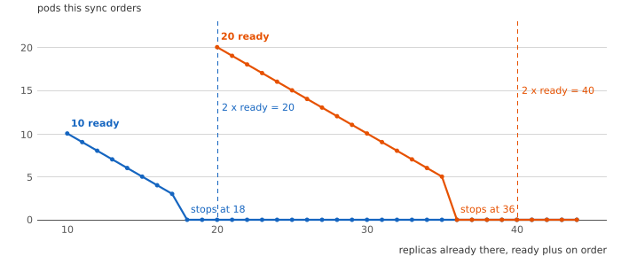
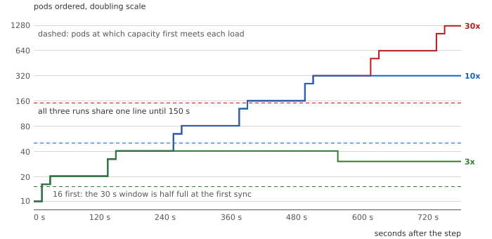
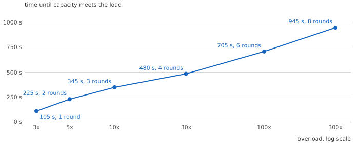
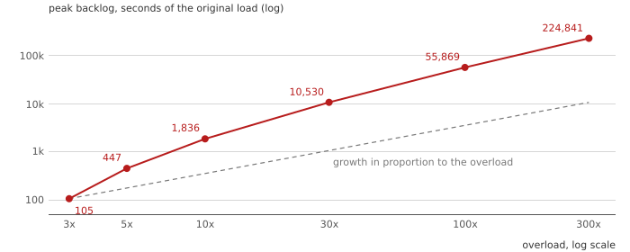
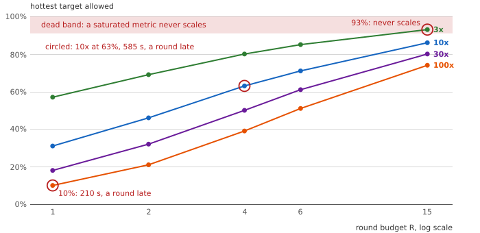
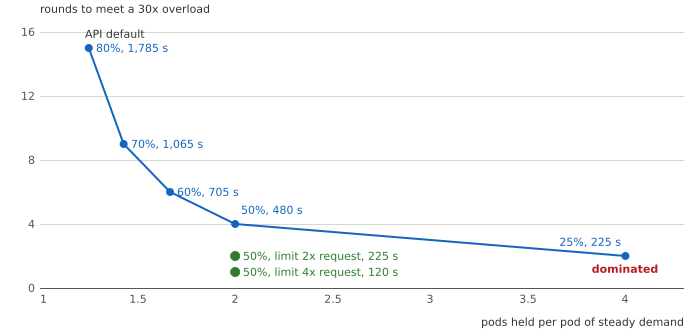
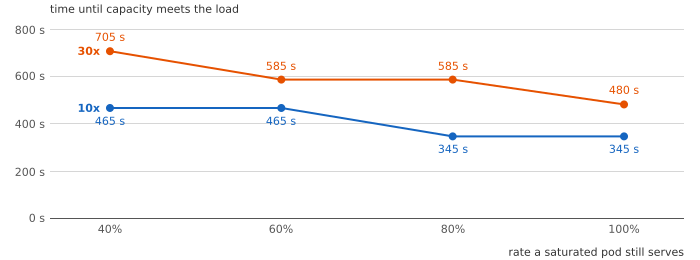
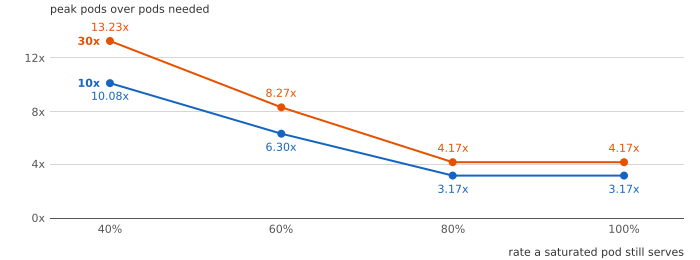
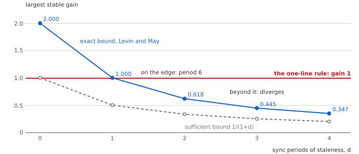

# Part 1: One Bit per Dead Time

Companion to [One Bit per Dead Time](https://e-mindset.space/blog/capacity-in-arrears-part1-one-bit-per-dead-time/).
The post states the argument; this page shows where each number comes from and how to
change the inputs. Layer tags follow the series: **Bound** (proof or source), **Fit**
(reading or approximation), **Estimate** (simulation).

## The question

When a utilization metric saturates, how fast can the Kubernetes Horizontal Pod Autoscaler
learn the size of an overload?

## The belief

The autoscaler's metric measures load, and its target is a cost setting. The API fills in a
CPU target of 80% when none is given (`DefaultCPUUtilization = 80`, see
[SOURCES.md](SOURCES.md)).

## The mechanism, as the code runs it

[`model/hpa_port.py`](../model/hpa_port.py) ports the replica calculation of
`replica_calculator.go` at v1.34.0. [`tests/test_hpa_port.py`](../tests/test_hpa_port.py) checks it
against eight cases from the upstream unit tests and two that pin the default tolerance of 0.1. Three rules decide everything that follows:

1. The usage ratio is computed over **ready** pods only, truncated to a whole percent.
2. On a scale-up, pods not yet ready are added back at **zero** usage and the ratio is recomputed.
3. The controller holds inside a 10% tolerance band, and a sync may at most double the count.

Rule 2 means a sync never orders more than twice the ready pods, however many are on order.
Section T29 sweeps it; [`figures/reach.svg`](../figures/reach.svg) draws it.



## The law

**Bound. Proposition 2.** With a saturated metric the ready pods grow by at most a factor
$g = \ell / (r\,u^\ast)$ per round, where $\ell$ is the CPU limit, $r$ the request and
$u^\ast$ the target. A round is one dead time plus one metric window. A k-fold overload
therefore needs at least

```math
R(k) = \left\lceil \log_g \frac{k\,u^\ast\,r}{\ell} \right\rceil
```

rounds before capacity meets it.

**Bound. Corollary 1.** If $g$ lies inside the tolerance band, a saturated metric never
scales: with the limit at the request, at every target of 91% or more (T22).

**Bound. Corollary 2.** Meeting a k-fold overload within R rounds needs
$u^\ast \le (\ell/r)\,k^{-1/(R+1)}$. The condition is necessary, not sufficient: the
tolerance band can still cost a round (T21, T23).

**Bound. Proposition 1.** The one-line rule quoted in the documentation, fed a replica count
d syncs old, settles at d = 0, oscillates with period 6 at d = 1, and diverges for d ≥ 2
(T1, T15).

## The results

| Figure | Section | What it shows |
|---|---|---|
|  | T18 | Pods ordered after a 3x, 10x and 30x step: one shared trunk until 150 s |
|  | T2 | Time until capacity meets the load: 105 s at 3x to 945 s at 300x, one round per doubling |
|  | T2, T34 | Peak backlog grows faster than the overload |
| | T46 | Round arithmetic for the peak: 320 pods at 10x against 317 simulated, never below the simulation, and 160 against 80 at 5x |
|  | T21 | The hottest target for each overload and round budget, with the dead band |
|  | T4 | Steady pods against rounds: the target is an information rate |
|  | T10 | Degraded pods: capacity arrives a round or two later |
|  | T10 | Degraded pods: overshoot up to 13.23 times the need |
|  | T15 | The exact stability bound against the one-line rule's gain of 1 |

**Fit.** The overshoot follows from round arithmetic: while capacity is short or a backlog
remains, the metric reads full and each round doubles the pods, so the peak follows how long
the backlog lasts (T46).

Every number above is in `expected/results.txt`; [CLAIMS.md](CLAIMS.md) maps each to its
section.

## The bill, and when the advice reverses

About two minutes per round in the specimen (90 s dead time, 30 s metric window). Fifteen
rounds for a thirtyfold overload at the 80% default. An overshoot of 1.33 to 6.46 times the
pods needed, worse when saturated pods lose efficiency. The advice reverses when the metric
cannot saturate in the overloads that matter: a limit far above the request (T3), or a
signal that counts waiting work, which is the subject of Part 2.

## What you can vary

The fluid loop is [`model/loop_sim.py`](../model/loop_sim.py). From the experiment folder (`capacity-in-arrears/`):

```bash
python3 -c "import sys; sys.path.insert(0, 'model'); from loop_sim import run, step
for dead in (30, 60, 90):
    o = run(step(10), 'cpu', dead=dead, horizon=3600)
    print(dead, o['t_cap'] - 60, o['peak'])"
```

prints `30 165 249`, `60 255 301` and `90 345 317`: seconds until capacity meets a tenfold
load, and the peak pod count. The function's defaults are the series' specimen (a 90 s dead
time, 10 pods at a 50% target); its docstring lists every input and output. Other inputs: `target` (percent), `limit` (limit over request), `n0`
(pods before the step), `eta` (efficiency of a saturated pod), `max_replicas`, and `step(k)`
for the overload. A hotter target slows the same step:

```bash
python3 -c "import sys; sys.path.insert(0, 'model'); from loop_sim import run, step
o = run(step(10), 'cpu', dead=90, target=70, horizon=3600)
print(o['t_cap'] - 60, o['peak'])"
```

prints `705 348`: at a 70% target the tenfold step takes 705 s and peaks at 348 pods.

## Model scope

A fluid queue, a fixed dead time, pods that report ready when they can serve, no timeouts or
retries in this part. [ASSUMPTIONS.md](ASSUMPTIONS.md) lists every assumption and what it
could change. The falsification criteria for this part, and their status, are in
[FALSIFICATION.md](FALSIFICATION.md).
