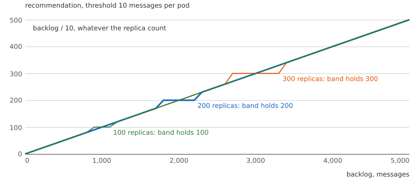
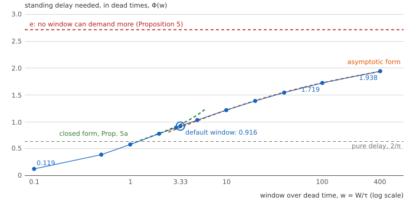
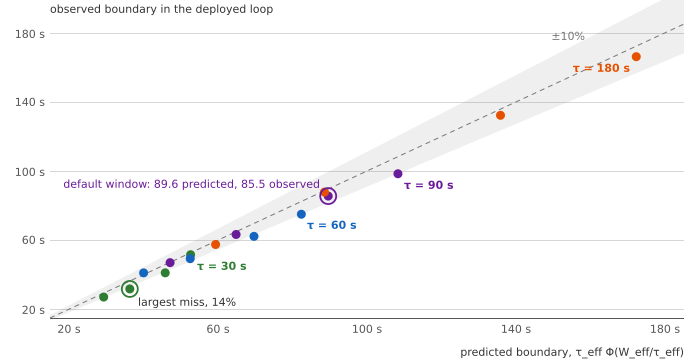
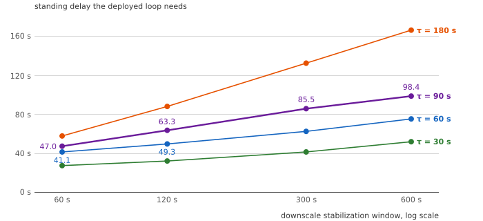
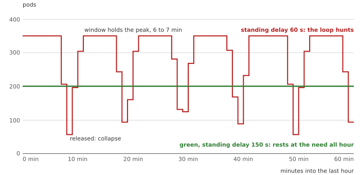
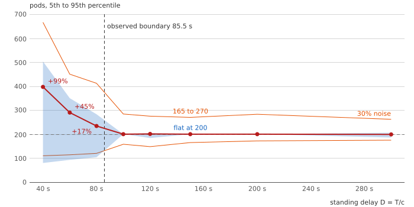

# Part 2: The Delay a Window Demands

Companion to [The Delay a Window Demands](https://e-mindset.space/blog/capacity-in-arrears-part2-the-delay-a-window-demands/).
Layer tags: **Bound** (proof or source), **Fit** (reading or approximation), **Estimate**
(simulation).

## The question

A queue consumer scaled on its backlog sees the size of an overload at once. What does the
provisioning delay do to such a loop, and what does a stabilization window, added to keep
it calm, do to it?

## The belief

A stabilization window makes an autoscaling loop stable. The Kubernetes documentation
presents the 300-second scale-down window as the remedy for flapping, and KEDA passes the
setting to the autoscaler unchanged (sources in [SOURCES.md](SOURCES.md)).

## The mechanism, as the code runs it

KEDA's default `AverageValue` metric reaches the controller's external per-pod path, which
recommends the backlog over the threshold whatever the current count, outside the 10%
tolerance band ([`model/hpa_port.py`](../model/hpa_port.py), sections T28 and T29). Pods
on their way do not shrink the backlog, so the loop orders past them on the way up. On the
way down the window holds the highest recommendation of the last W seconds.



**Estimate. One step, worked through** (T47). A consumer of 10 messages a second per pod, demand
stepping from 50 to 200 messages a second (5 to 20 pods needed), a 90 s dead time, the default
window, a ceiling of 100 and KEDA's default threshold of 10 messages per pod. Within 90 s the
controller orders 100 pods, five times the need, while only 10 are consuming; at two minutes the
backlog holds 14,850 messages and by 180 s it is gone. The window then holds the 100 pods for
five minutes, the count collapses to one, and the cycle repeats exactly every 510 seconds.

## The law

**Bound. Definition 4.** A threshold of T messages per pod at c messages a second per pod
holds every message for the standing delay $D = T/c$ at rest. The Kafka default of 10
messages per pod, at 10 messages a second, is one second.

**Bound. Proposition 3.** The pure-delay loop is stable iff $D > (2/\pi)\,\tau$, and its
characteristic equation has a real root iff $D \ge e\,\tau$.

**Bound. Proposition 4.** In the idealized loop, stability depends only on $D/\tau$ and
$W/\tau$: the loop rests after an upward step iff

```math
D \ge \tau\, \Phi\!\left(\frac{W}{\tau}\right)
```

The scaling is proven. That the stable gains form an interval, so that $\Phi$ is one curve,
is observed numerically for every window computed (T11), not proven.

**Bound. Proposition 5.** With $D \ge e\,\tau$ the loop recovers from an upward step without
overshoot, so the window never acts and $\Phi \le e$ for every window (T26, T14).

**Bound. Proposition 5b.** The ceiling is exact. With no window the loop settles at every
standing delay, so $\Phi(0) = 0$; for every $D < e\,\tau$ a long enough window makes the loop
hunt, because the pure-delay response then overshoots (it oscillates exactly when
$a\tau > 1/e$, Györi and Ladas 1991) and the window holds the overshoot until the swing grows.
So $\sup_w \Phi(w) = e$. That $\Phi$ rises steadily between its ends is observed, not proven
(T11, T27, T37). The loop is a differential equation with maxima (Bainov and Hristova, 2011);
whether that general theory contains these results was not settled.

**Fit. Proposition 5a.** Harmonic balance gives a closed form for windows of at least one
dead time, with $\alpha = \pi/(1+w)$:

```math
\Phi_{hb}(w) = \frac{(1+\cos\alpha) + (\pi+\alpha)\sin\alpha}{2\pi\alpha}
```

It is within 3.3% up to the default window. For long windows the form
$e/(1 + c/\ln^2(w/w_0))$ with $c = 30.6$, $w_0 = 0.07$ fits within 0.46% from 10 to 400
dead times (T37).

**Bound. Corollary 3.** A latency target below $\tau\,\Phi(W/\tau)$ cannot rest; any latency
of e dead times or more is safe against upward steps whatever the window.

## The results

| Figure | Section | What it shows |
|---|---|---|
|  | T11, T25, T37 | $\Phi(w)$ computed, with both approximations and the ceiling e |
|  | T12 | Sixteen deployed boundaries against the corrected curve: 6.0% mean miss |
|  | T12 | The boundary rises with the window at every dead time |
|  | T24 | The hunt at a 60 s standing delay against rest at 150 s |
|  | T13 | Pods and their spread against the standing delay, with 30% demand noise |

T38 checks the request-level simulator against exact results for server farms with setup
times (Gandhi, Harchol-Balter and Adan, 2010): where exact theory exists, the simulator
agrees with it within run-length noise.

## The bill, and when the advice reverses

About ninety seconds of waiting on every message at a 90-second dead time with the default
window, or a hunt that costs 17% to 99% more pods. The Kafka default supplies one second and
hunts with or without the window (T25). The advice reverses when the controller reads a rate
instead of a backlog: a rate has no integrator in it.

## What you can vary

$\Phi$ for any window, in dead times, from [`model/backlog_ideal.py`](../model/backlog_ideal.py),
run from the experiment folder (`capacity-in-arrears/`):

```bash
python3 -c "import sys; sys.path.insert(0, 'model'); from backlog_ideal import critical_a
for w in (1/3, 1.0, 3.33):
    print(round(w, 2), round(1 / critical_a(w), 3))"
```

prints `0.33 0.291`, `1.0 0.573` and `3.33 0.916`. Multiply by your dead time to get the
standing delay your consumer needs, then divide your threshold by your per-pod rate and
compare. The deployed loop is [`model/backlog_sim.py`](../model/backlog_sim.py)
(`run(T, lam0, lam1, c, dead, window, ...)`, threshold T in messages per pod), and
[`model/backlog_boundary.py`](../model/backlog_boundary.py) finds its boundary by bisection.

## Model scope

A fluid backlog, a constant per-pod rate, flat demand after an upward step, no partition cap,
no rebalance pauses unless asked for. [ASSUMPTIONS.md](ASSUMPTIONS.md) lists the rest. The
cluster criteria are in [FALSIFICATION.md](FALSIFICATION.md).
