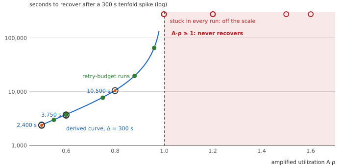
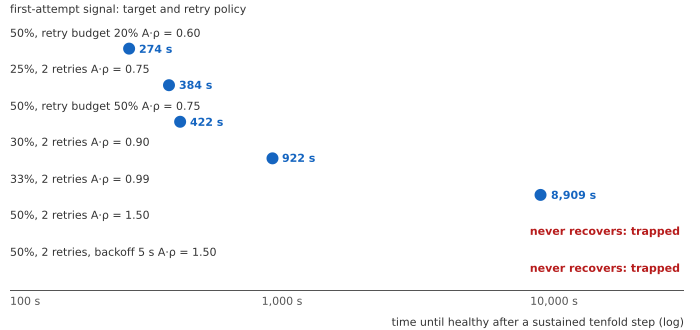
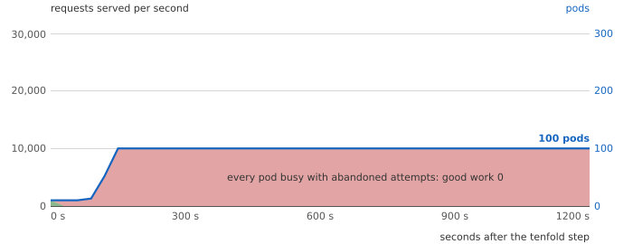
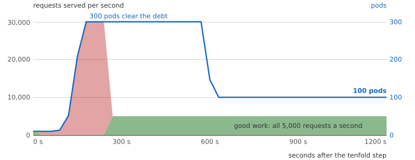

# Part 3: Demand Is Not Debt

Companion to [Demand Is Not Debt](https://e-mindset.space/blog/capacity-in-arrears-part3-demand-is-not-debt/).
Layer tags: **Bound** (proof or source), **Fit** (reading or approximation), **Estimate**
(simulation).

## The question

A signal that counts only first attempts sees demand cleanly and carries no backlog. What
does it miss when clients time out and retry?

## The belief

A cleaner signal, closer to what users ask for, is a safer one to scale on. Both platforms
support scaling on request rate, and filtering retries out of the signal is the natural next
step (sources in [SOURCES.md](SOURCES.md)).

## The mechanism, as the code runs it

[`model/loop_sim.py`](../model/loop_sim.py) adds client timeouts, immediate retries and
**wasted work**: a server keeps working on a request whose client has given up. That work is
retry debt. It consumes capacity, produces nothing anyone receives, and a first-attempt
signal cannot see it. [`model/request_sim.py`](../model/request_sim.py) checks the fluid
results request by request.

## The law

**Bound. Proposition 6 (attributed).** After a trigger has pushed waits past the client
timeout, the failed state is permanent iff $A_{fail}\,\rho \ge 1$, where $A_{fail}$ is the
work per first attempt while failing ($R + 1$ for R retries). The condition is already in
Bronson and coauthors' example; the series does not claim it.

**Bound. Proposition 7.** Below the threshold, recovery after a k-fold spike of length
$\Delta$ takes

```math
T_{rec} = \frac{(A k \rho - 1)(\Delta - t_0)}{1 - A\rho} + \frac{\tau_{out}}{1 - \rho},
\qquad t_0 = \frac{\tau_{out}}{k\rho - 1}
```

For a long spike this is $\Delta(Ak\rho - 1)/(1 - A\rho)$. The waits grow at $k\rho - 1$ until
they pass the timeout at $t_0$, at $Ak\rho - 1$ for the rest of the spike, then fall at $1 -
A\rho$ back to the timeout and at $1 - \rho$ for the last $\tau_{out}$. Across twelve spikes
the full form is within 1.2% of the fluid model, and within a quarter of a percent at the
cluster kit's marginal trigger: 2,873 s against 2,867, where the long-spike form gives 3,300
(T45).

**Bound. Proposition 8.** A spike is a trigger iff $(k\rho - 1)\Delta > \tau_{out}$. A
sustained step is a spike as long as the dead time. With a 90 s dead time and a 10 s timeout,
any overload above about 11% triggers before the first new pod serves.

**Bound. Corollary 4.** A scaler on a signal that excludes the debt holds $\rho$ at its target,
so after a trigger it is trapped at any target of $1/A$ or more.

**Bound. Corollary 5.** A scaler that counts every attempt sets $A\rho$ to its target and
escapes, provided it keeps the capacity until the debt has cleared.

## The results

| Figure | Section | What it shows |
|---|---|---|
|  | T6, T16 | Recovery time against $A\rho$: formula, fluid model, request-level runs, retry budgets |
|  | T7 | A first-attempt scaler by target and retry policy |
|  | T32 | First attempts: capacity at the need, all of it spent on debt |
|  | T32 | Ingress rate: three times the need, the debt cleared, back to the need |

T5 compares the three signals under the same tenfold step: CPU recovers after 771 s at 12.50
times the need, ingress after 266 s at 3.00, first attempts never. T30 shows no trap without
a trigger, at amplified utilizations up to 2.85. T33 multiplies retry stacks.

## The bill, and when the advice reverses

With two retries, a first-attempt target of a third or more turns a tenfold step into a
permanent failure with capacity at twice the demand. Scale on ingress, or pair the clean
signal with ingress so the larger recommendation wins. The advice reverses when the service
drops abandoned work (deadline propagation, cancellation): then the debt does not exist and
the clean signal is the best one.

## What you can vary

From the experiment folder (`capacity-in-arrears/`):

```bash
python3 -c "import sys; sys.path.insert(0, 'model'); from loop_sim import run, step
for retries in (2, 1):
    o = run(step(10), 'first', dead=90, target=30, timeout=10, retries=retries, horizon=20000)
    print(retries, o['last_bad'] - 60)"
```

prints `2 922` and `1 262`: seconds to recover at a 30% first-attempt target with two retries
and with one. Other inputs: `signal` (`'cpu'`, `'ingress'`, `'first'`, `'pair'`), `budget`
(a retry budget as a fraction of first attempts), `backoff`, `zombie=False` to drop abandoned
work.

## Model scope

A fluid queue, exponential service in the request-level check, perfectly persistent clients,
no circuit breakers. [ASSUMPTIONS.md](ASSUMPTIONS.md) lists the rest; the cluster criteria
are in [FALSIFICATION.md](FALSIFICATION.md).
