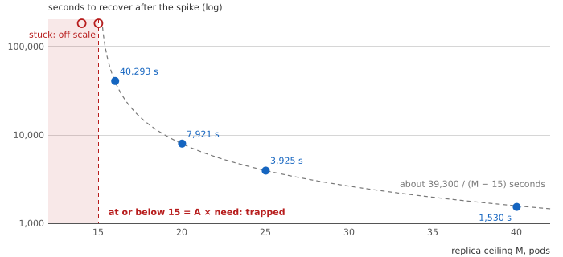
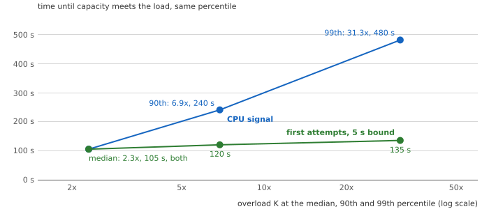
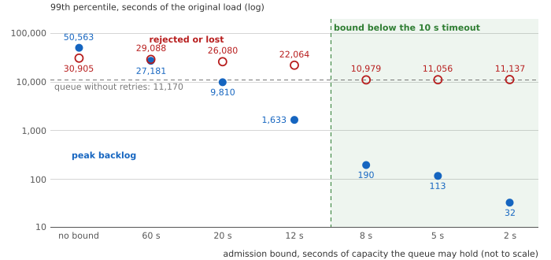
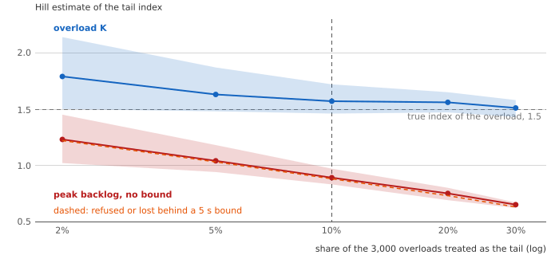
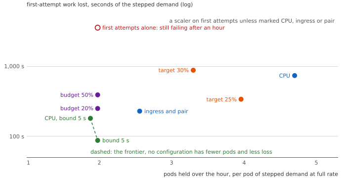

# Part 4: The Barrier the Scaler Cannot Hold

Companion to [The Barrier the Scaler Cannot Hold](https://e-mindset.space/blog/capacity-in-arrears-part4-the-barrier-the-scaler-cannot-hold/).
Layer tags: **Bound** (proof or source), **Fit** (reading or approximation), **Estimate**
(simulation).

## The question

During the provisioning delay the autoscaler can change nothing. What can, and what does each
choice cost?

## The belief

A limit removes a risk: a replica ceiling, a retry cap, a queue size. KEDA gives every scaled
object a ceiling of 100 replicas by default (sources in [SOURCES.md](SOURCES.md)).

## The mechanism, as the code runs it

[`model/loop_sim.py`](../model/loop_sim.py) adds an **admission bound**: the queue holds at
most b seconds of its current capacity, and work beyond that is refused at the door at no
service cost. [`model/tail_study.py`](../model/tail_study.py) draws 3,000 Pareto overloads and
records time to capacity, peak backlog and refused or lost work for each.

## The law

**Bound. Proposition 9.** Within one dead time the autoscaler has zero authority over the
queue: $dL/dt = \lambda_{adm}(t) - C(t)$, and $C(t)$ is fixed by orders placed before the
horizon. Only admission, retry policy and capacity held in advance act.

**Bound. Proposition 10.** An admission bound shorter than the client timeout leaves no retry
debt, so the trap of Part 3 cannot hold.

**Bound. Proposition 11.** A replica ceiling $M \le A\lambda/c$ keeps a failing service failed;
above it the debt drains at $c(M - A\lambda/c)$, so recovery falls as one over the margin.

**Bound. Corollary 6.** A safe ceiling satisfies $A\lambda/c < M \le 0.8\,N_{max}$; when the
amplified need exceeds the scalability limit, no ceiling is safe.

**Bound. Definition 11.** The lever achievable region maps each setting of the three levers
(a colder target, a retry budget, an admission bound) to steady pods per pod of demand against
first-attempt work lost; a setting is on the frontier if no other has both fewer pods and less
loss.

**Bound. Definition 13.** The tail achievable region maps each admission bound to the 99th
percentiles of peak backlog and of refused or lost work over heavy-tailed overloads.

**Bound. Proposition 12.** A peak backlog that grows like $K \log K$ has the same tail index as
the overload K, though over any observed range it looks heavier.

## The results

| Figure | Section | What it shows |
|---|---|---|
|  | T17 | Recovery against the replica ceiling: trapped at or below the amplified need |
|  | T9 | Time to capacity stays light-tailed while the overload is heavy-tailed |
|  | T35, T43 | 99th percentiles by admission bound: the cliff at the 10 s timeout |
|  | T49 | Hill estimates with 90% bootstrap bands against the share treated as the tail: the backlog's index stays below the overload's and climbs toward it in the deep tail |
|  | T48 | Every signal and lever of Parts 3 and 4 on common axes: only the two configurations behind an admission bound reach the frontier |

**Estimate. The three levers** (T7, T8), under the same sustained tenfold step with a 10 s
timeout, two retries and a scaler on first attempts, with work lost in seconds of the stepped
demand:

| Lever | Steady pods per pod of demand | Who must cooperate | First-attempt work lost |
|---|---|---|---|
| Target lowered to 25% | 4 | nobody | 338 s |
| Retry budget of 20%, target 50% | 2 | every client | 249 s |
| Admission bound of 5 s, target 50% | 2 | nobody | 87 s |

The bound dominates both alternatives for this overload: it holds the same two pods as the
retry budget and loses about a third as much work, and it loses about a quarter as much as
the colder target while holding half the pods. It is also the only lever the service team
can deploy alone. Without any lever the same configuration stays failed.

On common axes (T48), pods held over the hour per pod of demand against work lost, only the
first-attempt scaler behind a 5 s bound (1.98 pods, 87 s) and the CPU scaler behind it (1.88,
180 s) reach the frontier; every colder target, retry budget and unbounded signal holds more
pods, loses more work, or both.

**Estimate. How sure the tail indices are** (T49). With the top 10% treated as the tail, the
overload's Hill estimate is 1.57 (90% bootstrap interval 1.46 to 1.72) and the backlog's 0.89
(0.83 to 0.97): the gap is not sampling noise. The choice of tail moves both more than
resampling does, from 1.79 and 1.23 at the top 2% to 1.51 and 0.65 at the top 30%.

T36, T41 and T42 size the cluster predictions.

## The bill, and when the advice reverses

Refused requests carrying the overload's own excess: on the CPU signal, 11,056 seconds of base
load at the 99th percentile against 11,170 that a queue without retries would hold. A signal
that reaches capacity sooner shrinks it: 3,535 on first attempts behind the same bound. The
advice reverses when refusing work costs more than delaying it, for example writes that cannot
be retried.

## What you can vary

From the experiment folder (`capacity-in-arrears/`):

```bash
python3 -c "import sys; sys.path.insert(0, 'model'); from loop_sim import run, step
for b in (5, 8):
    o = run(step(5), 'cpu', dead=90, n0=4, max_replicas=50, timeout=10, retries=2, shed_s=b, horizon=7200)
    print(b, o['peak'], round(100 * o['lost'] / o['first'], 1))"
```

prints `5 21 1.2` and `8 23 1.2`: the bound in seconds, the peak pod count and the demand lost
in percent, at the cluster kit's size. `tail_study.study(alpha, n, **kw)` takes the same
keywords for a heavy-tailed sweep; `alpha` is the tail index.

## Model scope

Sustained steps rather than bursts, a bound measured against current capacity that does not
fall while a request waits, no correlated overloads. The achievable regions carry no price
for a miss: choosing a point on a frontier takes that price, and only the service can set it.
They count the users' side as volume (seconds of demand lost or of delay) rather than as a
share of requests inside a latency target or an error budget. [ASSUMPTIONS.md](ASSUMPTIONS.md) lists the
rest; the cluster criteria are in [FALSIFICATION.md](FALSIFICATION.md).
