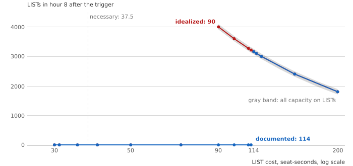

# Correct in Isolation

**The code and data behind the blog series
[Correct in Isolation: Shared Signals, Time Scales, State, Assumptions, and Order](https://e-mindset.space/blog/correct-in-isolation-part1-two-setpoints-for-one-number/)
on [e-mindset.space](https://e-mindset.space).**

The most dangerous sentence in a design review is "every component is correct", because it is
usually true. The series takes mechanisms of one control plane that each honour their documented
contract, finds what two of them share, and derives the condition under which the pair fails while
each part passes. This folder holds everything the series' numbers come from: the simulations, the
closed forms they are checked against, their frozen output, and the figures drawn from it.

| Part | Post | What it finds | Here |
|---|---|---|---|
| 1 | [Two Setpoints for One Number](https://e-mindset.space/blog/correct-in-isolation-part1-two-setpoints-for-one-number/) | A horizontal and a vertical autoscaler on one CPU metric rest only inside a narrow band of targets; below it the replica count climbs a staircase with requested CPU unchanged | [docs/part1](docs/part1-two-setpoints-for-one-number.md) |
| 2 | [Headroom Bought by the Round](https://e-mindset.space/blog/correct-in-isolation-part2-headroom-bought-by-the-round/) | A pod autoscaler nested in a node autoscaler pays a node wait every round; headroom is bought by the round, and the memory a surge leaves pays only when kept as pods | [docs/part2](docs/part2-headroom-bought-by-the-round.md) |
| 3 | [A Watch Delayed Becomes a List](https://e-mindset.space/blog/correct-in-isolation-part3-a-watch-delayed-becomes-a-list/) | Overload protection and the client's re-list rule share the delay; past a list cost they lock into a storm that spends all capacity on lists, which the server's wait limit delays but does not prevent | [docs/part3](docs/part3-a-watch-delayed-becomes-a-list.md) |
| 4 | [The Guarantee Nobody Breaks](https://e-mindset.space/blog/correct-in-isolation-part4-the-guarantee-nobody-breaks/) | A start-time cycle strands a cluster while every component keeps its guarantee; a webhook that rejects its own pods cannot heal, and one rolling upgrade removes it or stalls at a stuck eviction | [docs/part4](docs/part4-the-guarantee-nobody-breaks.md) |
| 5 | [The Second Pass Is the Last](https://e-mindset.space/blog/correct-in-isolation-part5-the-second-pass-is-the-last/) | Idempotent webhooks in an order nobody promises: two passes repair one enabling step, a link through a selector is never repaired, and a second admission of the admitted pod tells which | [docs/part5](docs/part5-the-second-pass-is-the-last.md) |
| 6 | [Every Pair Passes](https://e-mindset.space/blog/correct-in-isolation-part6-every-pair-passes/) | Seams of every order for a shared signal, assumption and order, invisible to every smaller check; a whole-system test for each seam, run as an audit in the order the seams bind | [docs/part6](docs/part6-every-pair-passes.md) |




*LISTs still running eight hours after a trigger, against the cost of one LIST. A storm that holds spends all capacity on LISTs, the gray band both storms sit on. The idealized queue storms from a cost of 90, the real server, with its wait limit and the client's backoff, from 114, and each line breaks where the count jumps. Below 37.5 no order of service can sustain a storm.*

## Check it yourself

Python 3.10 or later, standard library only. Nothing to install. From this folder:

```bash
python3 reproduce.py --check            # the tests, then every number, byte for byte: prints "identical"
python3 reproduce.py --figures --check  # redraws all 33 figures and compares: "figures identical"
python3 reproduce.py T41                # one section: the numbers behind one table or figure
```

The full check takes about four minutes on one core of a recent machine; it starts with the tests.

## Audit your own cluster

`audit/seam_audit.py` runs the five whole-system tests of Part 6 on a cluster's own objects, with no cluster access of its own:

```bash
kubectl get mutatingwebhookconfigurations,validatingwebhookconfigurations,namespaces,hpa,vpa -A -o json > cluster.json
python3 audit/seam_audit.py cluster.json --description description.json   # description optional
```

It reports each seam's ratio and whether it binds. The objects give the signal, assumption and order tests; the
optional description adds what no object records: the facts each mutating webhook writes and needs, the
informers and their list costs, the server's capacity and history, and the surge to plan for (the fixture in
`tests/test_seam_audit.py` shows the format). An incomplete description can hide an assumption, order or state
failure but never invent one, and a coupling it leaves out can move the signal's verdict either way.

## What is where

| Folder | Contents |
|---|---|
| [`model/`](model/) | The simulations: the two autoscalers on one metric with the vertical recommender's decaying histogram (`hpa_vpa.py`), the pod autoscaler nested in the node autoscaler with scale-up and scale-down (`nested.py`), informers behind a queue, idealized, with its wait limit and the client's backoff, and with fair queuing (`relist.py`), recovery from failures with start-time dependencies (`recovery.py`) and random start-time graphs (`percolation.py`), mutating admission in sequence, with an orchestrator that iterates it (`admission.py`), the tails of surge sizes and list costs (`tail_buffer.py`, `tail_lists.py`), the whole-system tests (`audit.py`), the order of a seam, its ratio and incomplete descriptions (`interaction.py`, `ratios.py`, `incomplete.py`), a supervisor for the whole (`supervisor_whole.py`), current collectors' cost data (`gc_data.py`), and every closed form of the posts by seam (`formulas_signal.py`, `formulas_time.py`, `formulas_state.py`, `formulas_assumption.py`, `formulas_order.py`, `formulas_whole.py`), gathered under one name by `formulas.py` |
| [`sections/`](sections/) | The sections `reproduce.py` collects, one module per part (`part1.py` to `part6.py`), and the constants two parts share (`common.py`) |
| [`tests/`](tests/) | Each closed form against the simulation, each safeguard alone, the client backoff against its source, and the transcribed data |
| [`expected/`](expected/) | `results.txt`: the frozen output every post quotes |
| [`tla/`](tla/) | The formal side checked with TLC: one TLA+ specification per seam, each contract holding alone and failing composed, the network bound included, with the frozen verdicts and a runner that needs Java and `tla2tools.jar` |
| [`p/`](p/) | The hidden memory checked with P: models of Part 3's backoff, Part 4's repair race and Part 5's second pass as communicating state machines, what each abstracts and why it is sound (`p/README.md`), the frozen verdicts and a runner that needs the .NET 8 SDK and the `p` tool |
| [`audit/`](audit/) | `seam_audit.py`, the five whole-system tests run on a cluster's own objects |
| [`figures/`](figures/) | The figures as SVG, and `figspec.py`, which builds them from the results |
| [`docs/`](docs/) | A page per part; [CLAIMS](docs/CLAIMS.md), every claim mapped to its evidence; [SECTIONS](docs/SECTIONS.md), what each section prints; [FALSIFICATION](docs/FALSIFICATION.md), the predictions and their status; [ASSUMPTIONS](docs/ASSUMPTIONS.md); [SOURCES](docs/SOURCES.md), the documentation and source read; [NOTATION](docs/NOTATION.md), every symbol of the series; [FIELD_GUIDE](docs/FIELD_GUIDE.md), each seam's symptom, test and fixes for an operator |

`reproduce.py` is the entry point for the results and `audit/seam_audit.py` for auditing a cluster; the model files are
libraries with no entry point of their own. The simulators take their settings as one record (`PairSettings` in
`hpa_vpa.py`; a `SplitController` in `relist.py`) and return one (`PairRun`, `LimitedRun`). The model's defaults are the series' specimen, and each function's docstring lists its
inputs and outputs. `experiment.json` describes this experiment for the repository's tools.

## How far to trust it

Every result carries the series' layer tag. **Bound** results are proofs, or facts read from the
documentation or the source. **Fit** results are readings or approximations. **Estimate** results come
from these simulations under the assumptions in [ASSUMPTIONS.md](docs/ASSUMPTIONS.md). Where a contract
leaves behavior open, the model takes the worst case it allows, and every simulation states its trace
inputs. **None of it has been run on a real cluster.** The falsification criteria say what a run would
have to show to refute each part.

## Cite

See the repository's [CITATION.cff](../CITATION.cff). Behavior modeled from Kubernetes source
(Apache-2.0) is listed in [NOTICE](NOTICE).
