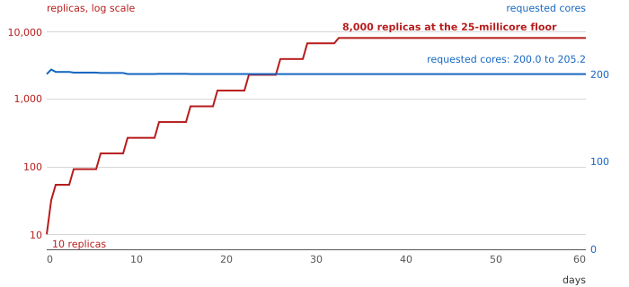
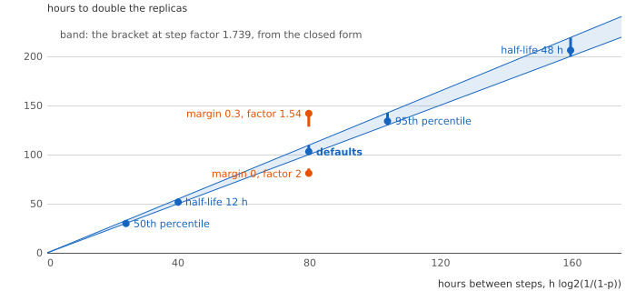

# Part 1: Two Setpoints for One Number

Companion to [Two Setpoints for One Number](https://e-mindset.space/blog/correct-in-isolation-part1-two-setpoints-for-one-number/).
The post states the argument; this page shows where each number comes from and how to change the inputs.
Layer tags follow the series: **Bound** (proof or source), **Fit** (reading or approximation), **Estimate**
(simulation).

## The question

When a horizontal and a vertical pod autoscaler both act on one CPU metric, as their documentation warns
against, can the pair rest at all, and if not, what does it do?

## The belief

Each autoscaler is tuned and tested, so two of them on one deployment are safe. The vertical autoscaler's
documentation names one pairing to avoid and recommends another, and the reader is left to assume the rest
behave.

## The mechanism, as the code runs it

[`model/hpa_vpa.py`](../model/hpa_vpa.py) runs the horizontal ratio rule with its tolerance of 0.1 against the
vertical recommender as documented: a decaying histogram of usage with a 24-hour half-life, the 90th
percentile, a 15% margin and a 25-millicore floor. The histogram's buckets are 5% wide, as the current
recommender implements them. The horizontal loop holds utilization at its target; the vertical loop holds it
at $1/((1+m)q)$, 0.870 at the defaults and a steady load (T2).

## The laws

- **Fit. Definition 0.** A mechanism is defined by five interface components, and a seam is what two mechanisms
  share among them: a signal, a time scale, state, an assumption or an order. The classification is a modeling
  choice; an interaction no contract records lies outside it.

- **Bound. Proposition 2.** On one metric the two loops' gain matrix is singular, so Bristol's relative gain is
  undefined (T1).
- **Bound. Proposition 3.** The pair rests only for targets inside a band set by both loops' tolerances: 0.791
  to 0.966 for a steady load, at most 0.719 to 1.074 with the vertical update threshold, only the lower side on a strictly steady load (T2,
  [rest-band](../figures/rest-band.svg)).
- **Bound. Proposition 4.** Below the band the replica count climbs a staircase. The vertical loop moves every
  79.73 hours at the defaults and each move multiplies the count by $1/((1+m)u_h)$; the doubling time lies in a
  bracket that the bucket width sets (T4, T23, [drift](../figures/drift.svg)).
- **Bound. Propositions 6 and 7.** The recommended split has relative gain
  $(1+\beta\theta_L)(1-\xi)/((1+\beta\theta_L)(1-\xi)-\beta\theta)$, which is $1/(1-\beta\theta)$ for a live set that
  ignores load and $1+\beta\theta$ for one that follows it; a heap that grows into its limit ($\xi$) turns it singular
  again (T1, T39, T118, [coupling](../figures/coupling.svg)). A custom metric that depends on CPU has $1/(1-\gamma)$ (T19).

## The gap and the intervention

- **Bound. Proposition 1.** Each loop settles, eventually and always inside its rest set, against a frozen
  partner; the composite needs the two rest sets to meet.
- **Bound. The band's edge.** The drift rate, $\ln F/s^\ast$, falls to $\ln(1+\text{tol})/s^\ast$ at the edge
  and jumps to zero inside it: a doubling every 579.7 hours at 0.7905, none at 0.791 (T92).
- **Bound. Proposition 5.** With a lognormal factor on per-pod usage, $q(\sigma) = \exp(z_p\sigma - \sigma^2/2)$
  rises to 2.2732 at $\sigma = 1.2816$ and falls after; a 50% target drifts up, rests, drifts down, rests and
  drifts up again as the tail grows (T90). The branches past $\sigma \approx 1.2$ hold only for many pods with
  unclipped samples (T113).
- **Bound. The resting frontier.** The highest target that can rest is $1/(q(1-\text{tol}))$, 0.4888 at the peak of $q$
  (T92).
- **Estimate. Definition 5, hidden memory.** Runs from the same visible state diverge by what the histogram remembers (T103,
  `prior` in `simulate`); the TLA+ specification `tla/SharedSignal.tla`, which has no histogram, is checked by TLC.
- **Estimate. The supervisor.** Setting the margin from the histogram every $T$ hours halts the drift at a
  plateau that grows with $T$, and saturates where the margin it needs is negative (T91).
- **Estimate. A fix in transit.** Applied mid-drift, a target in the band or a matched scale-up tolerance stops the
  staircase where it stands and does not undo it (T119, `change` in `simulate`).

## The numbers

Every claim, with its section, is in [CLAIMS.md](CLAIMS.md). The staircase at a 0.5 target (T23), the doubling
bracket and the replica counts (T4, T21, T22), the margin a shared pair would need to rest (T20), the
recommender's settings (T24), and the coupling from collectors of 2005 and 2022 (T5, T39).

## What you can vary

The recommender's percentile, half-life and margin are parameters of `simulate` in `model/hpa_vpa.py`, and
section T24 shows them varied. The closed forms are in [`model/formulas.py`](../model/formulas.py):
`equilibrium_band`, `step_interval`, `step_factor`, `doubling_bracket`, `coupled_relative_gain`,
`custom_metric_relative_gain`, and for the tail `lognormal_q`, `pareto_q`, `regime`, `regime_boundaries`,
`drift_rate`, `max_resting_target`; `simulate` takes `noise_sigma` and `supervisor_h`. The assumptions, and what changes if each is wrong, are in
[ASSUMPTIONS.md](ASSUMPTIONS.md).
