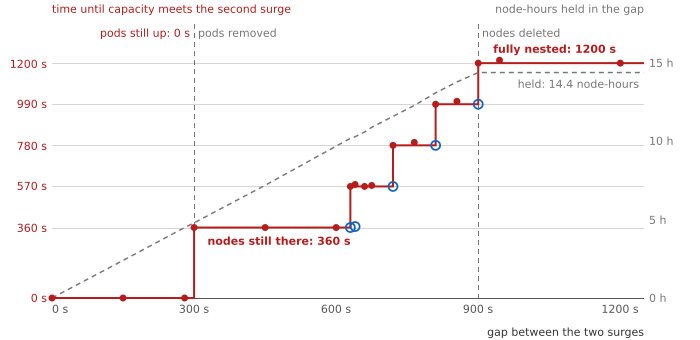

# Part 2: Headroom Bought by the Round

Companion to [Headroom Bought by the Round](https://e-mindset.space/blog/correct-in-isolation-part2-headroom-bought-by-the-round/).
The post states the argument; this page shows where each number comes from and how to change the inputs.
Layer tags follow the series: **Bound** (proof or source), **Fit** (reading or approximation), **Estimate**
(simulation).

## The question

When a pod autoscaler can only add pods inside capacity a node autoscaler provides, what does a surge cost,
what does spare capacity buy, and what does the memory a surge leaves behind buy for the next one?

## The belief

A fast loop nested inside a slow one behaves as if the slow one were not there, and the slow one adds its delay
once.

## The mechanism, as the code runs it

[`model/nested.py`](../model/nested.py) runs the pod autoscaler's documented rules, with pods not yet ready
counted at zero on a scale-up and the default scale-up policy, against the node autoscaler acting only on
unschedulable pods. `simulate_two_surges` adds both controllers' documented scale-down rules: the pod
autoscaler's stabilization window and the node autoscaler's unneeded time, bulk deletion of empty nodes and the
delay after a scale-up.

## The laws

- **Bound. Proposition 8.** With no free slot at the start of any round, a surge needing $R$ rounds takes
  $R(\tau_{\text{pod}} + \tau_{\text{node}})$ (T6, T7, [nested](../figures/nested.svg),
  [node-time](../figures/node-time.svg)).
- **Bound. Proposition 9.** Free slots covering $c$ rounds remove $c$ node waits at a geometric price; between
  steps more headroom can be slower (T8, T25, T26, [headroom](../figures/headroom.svg)).
- **Bound. Proposition 10.** Nodes a surge leaves behind cover only the rounds of the next surge placed before
  they are deleted (T28, [second-surge](../figures/second-surge.svg)).
- **Bound. Proposition 11.** The same memory kept as pods holds the same node-time and never serves later (T33).
- **Bound. Corollaries 1 and 2 and Propositions 12 to 16.** For a known gap only two settings are efficient
  ([unneeded](../figures/unneeded.svg)); with memoryless gaps the cheapest memory is one of a few settings
  ([memoryless](../figures/memoryless.svg), [pod-memory](../figures/pod-memory.svg)); against the worst gap
  break-even holding costs under twice what knowing the gap would ([worst-gap](../figures/worst-gap.svg));
  with gaps that cluster the hazard rule sets a finite window ([hazard](../figures/hazard.svg)); past the
  hour the lagged rule applies (T29 to T40).

*Leftover capacity helps only while it lasts. Time until capacity meets a second 30x surge (red, left axis) and the node-hours held in the gap (gray dashed, right axis). While the first surge's pods are still up, the second costs nothing. After that, each round the leftover nodes no longer cover adds a 210-second node wait, while the node-hours keep rising. Open blue points: the documented bulk deletion, which only shifts the steps.*

## The gap and the intervention

- **Bound. Deadlines alone, liveness together.** In isolation each loop meets a deadline, and nested the pair stays live; its own
  deadline grows with the surge (T93).
- **Bound. Proposition 17.** With surge sizes Pareto of exponent $a$ above the saturating surge, the rounds have
  a geometric tail and the mean nested time is finite for every $a$, while the mean pod-seconds short is
  finite only above 1; nesting multiplies its node-wait part by $1/(1-g^{1-a})$ (T94).
- **Bound. Corollary 3.** The cheapest headroom covers more rounds as the exponent falls, without bound at 1
  (T95).
- **Estimate. The controller.** Estimating the exponent after every surge holds within 1.5% of the cost of
  knowing it (T96).
- **Bound. Proposition 18.** Replica counts capped at maxReplicas, read as exact sizes, make the tail look
  lighter and can carry an exponent below 1 across it; read as censored they do not (T96). At a 50% target the pod
  autoscaler settles at $k\,n_0$ replicas after a $k$-fold surge, so a maximum of ten times the running pods is a
  cap of tenfold.

## The results

Every claim, with its section, is in [CLAIMS.md](CLAIMS.md).

## The bill, and when the advice reverses

1,200 seconds for a thirtyfold surge where 360 would do; fourteen times the running pods held idle to remove every wait; a frontier with cliffs, where a little more headroom can cost a round. After a surge, the default scale-down memory serves a second surge in full only within 630 seconds; later than that it either deletes nodes mid-ramp or holds 14.4 node-hours that buy nothing. With gaps that have no memory, ten minutes is never the cheapest setting at any price. Against the worst gap it costs up to 2.57 times what knowing the gap would. The same fifteen minutes kept as pods instead of empty nodes would serve every second surge inside them at once, for the same node-hours.

**When the advice reverses.** The advice of this post is to multiply a pair's dead times by the rounds a surge needs and to buy headroom by the round. It reverses when the metric does not saturate, so that one round sizes the surge: then nesting costs one node wait, as the documented sum says. The advice to buy headroom reverses at or below a tail exponent of 1, where no headroom bounds the expected cost and the surge accepted has to be bounded instead.

## What you can vary

`simulate` and `simulate_two_surges` in `model/nested.py` take the surge size, the pods per node, the two dead
times, the windows and the bulk of deletion; their defaults are the specimen. The closed forms are in
[`model/formulas.py`](../model/formulas.py): `rounds`, `nested_time`, `headroom_for`, `second_surge_time`,
`expected_held`, `expected_time`, `break_even`, `pod_break_even`, `hazard_window`, `node_tail_slope`, and
for the tail `ramp_shortfall`, `pareto_shortfall`, `nesting_multiplier`, `optimal_cover`, `pareto_mle`,
`censored_naive`, `censoring_crossing`; the controller is `run` in
[`model/tail_buffer.py`](../model/tail_buffer.py), and `simulate` takes `shortfall`. The
assumptions are in [ASSUMPTIONS.md](ASSUMPTIONS.md).
