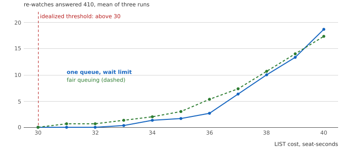

# Part 3: A Watch Delayed Becomes a List

Companion to [A Watch Delayed Becomes a List](https://e-mindset.space/blog/correct-in-isolation-part3-a-watch-delayed-becomes-a-list/).
The post states the argument; this page shows where each number comes from and how to change the inputs.
Layer tags follow the series: **Bound** (proof or source), **Fit** (reading or approximation), **Estimate**
(simulation).

## The question

The API server's overload protection delays requests, and a client whose watch comes back after the retained
history must list again. When does the delay they share turn a trigger into a storm of lists that sustains
itself?

## The belief

Each safeguard is stable on its own, so a server with both is stable.

## The mechanism, as the code runs it

[`model/relist.py`](../model/relist.py) has three versions of the server. `simulate` is the idealized queue,
first in first out with no wait limit. `simulate_limited` adds the server's queue wait limit, 15 seconds at the
default request timeout and then a 429, and the client-go Reflector's backoff as its source defines it.
`simulate_fair` replaces the single queue with fair queuing at the defaults of the "system" priority level.
[NOTICE](../NOTICE) lists the Kubernetes source each is modeled from.

## The laws

- **Bound. Each safeguard alone.** Each safeguard alone lists only what the trigger forced (T12, T41).
- **Bound. Proposition 19.** In the idealized queue a second wave starts iff the backlog outlasts the shortest
  watch plus the history, and a storm needs it to pass the mean watch plus twice the history (T10, T11).
- **Bound. Proposition 20.** With the wait limit a re-watch reaches a 410 only after a run of consecutive
  rejections, at least four (T45).
- **Bound. Proposition 21.** Under any order of service a saturated storm needs the backlog to pass the mean
  watch plus the history (T41, [storm](../figures/storm.svg)).

*Where the second wave starts. The idealized queue answers its first re-watch with 410 exactly above a LIST cost of 30, where the forced backlog outlasts the shortest watch plus the history. With the wait limit and the client's backoff the first 410s appear at 31 to 33 and grow from there, with fair queuing and with one queue alike.*

## The gap and the intervention

- **Bound. Every contract holds, by construction.** Both safeguards keep their safety contracts in a storm, and neither bounds the time
  from a 410 to the next list (T97).
- **Bound. Proposition 22.** A saturated storm needs the summed list work to pass the mean watch plus the
  history, however it is split; with Pareto list costs the simulated onset sits at one backlog, and a heavy tail
  turns the onset into a probability over cluster sizes (T98).
- **Fit. The mean-field fold.** One equation gives the storm's onset: 108.1 with fresh backoffs, 4% below the simulated
  113, and 98.9 with raised ones. It treats rejections as independent and leaves out the wait of the two admitted
  attempts (T108).
- **Bound. The network.** With partitions bounded by the history TLC finds no 410; one tick longer, a 410
  (`tla/SharedQueue.tla`).
- **Estimate. The cascade.** A partial trigger's storm reaches every informer it never forced above the onset (T105).
- **Estimate. The hold's frontier.** A failing band of holds around the history (T104).
- **Estimate. The controller.** Moving lists to a priority level of their own while 410s persist ends storms;
  without a hold it hunts; on the default streaming path no FlowSchema can express it (T99).

## The results

Every claim, with its section, is in [CLAIMS.md](CLAIMS.md): the second wave with the wait limit (T42,
[second-wave](../figures/second-wave.svg)), the storm and its onset (T41, T43, T44), the rejection runs
(T45), and the rejection shares that make the onset sharp (T46).

## The bill, and when the advice reverses

In the specimen, a second wave from a list cost of about 31 seat-seconds, a storm from 114 that spends all capacity on lists indefinitely, and a wait limit that protects only between about 90 and 114. With the watch cache's two and a half minutes of history, a storm from 79. Near the onset, storms that end by themselves only after hours, up to 56 hours in the runs; and without bookmarks, narrow watches that list steadily with no trigger at all.

**When the advice reverses.** The advice of this post is to compute the backlog a full trigger would build and to keep it below the mean watch plus the history. It reverses where re-watches are not cheap, as for watches that must resend their initial state. A delayed re-watch then already costs what a list costs, and there is no ratio for the delay to multiply.

## What you can vary

Each `simulate` function takes the list cost, the number of informers, the capacity, the history, the watch
periods, the trigger's share and spread, and the wait limit; `ReflectorBackoff` takes the backoff's constants.
The closed forms are in [`model/formulas.py`](../model/formulas.py): `backlog`, `second_wave`,
`failed_state_possible`, `saturated_storm_possible`, `rejections_before_gone`, `fresh_rejections_to_pass`;
the tail of list costs is [`model/tail_lists.py`](../model/tail_lists.py), and `simulate_limited` takes a
`controller` that splits lists from re-watches. The
assumptions are in [ASSUMPTIONS.md](ASSUMPTIONS.md).

## How much history a watch has

The documented history is five minutes, for etcd. Informer watches are served by the watch cache, whose resize rule
(`watch_cache_span` in [`model/formulas.py`](../model/formulas.py)) keeps 75 to 300 seconds at a steady event rate.
Section T57 replays that rule by event rate and reruns the queue with its wait limit at 150 and 75 seconds of history.
