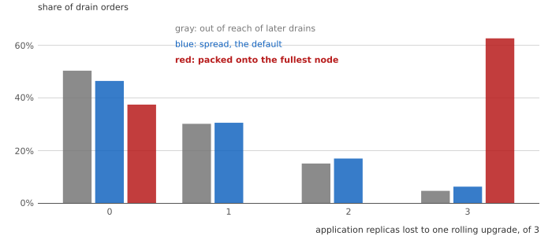
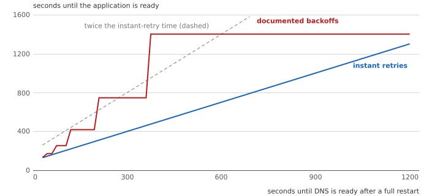

# Part 4: The Guarantee Nobody Breaks

Companion to [The Guarantee Nobody Breaks](https://e-mindset.space/blog/correct-in-isolation-part4-the-guarantee-nobody-breaks/).
The post states the argument; this page shows where each number comes from and how to change the inputs.
Layer tags follow the series: **Bound** (proof or source), **Fit** (reading or approximation), **Estimate**
(simulation).

## The question

When admission webhooks, DNS and the workloads they serve each guarantee their behavior only while the others
run, when does the cluster fail to recover, why can no check of one component see it, and what does ordinary
maintenance do to a webhook that rejects its own pods?

## The belief

Every component passes its own checks, so the cluster recovers from any failure each component can survive.

## The mechanism, as the code runs it

[`model/recovery.py`](../model/recovery.py) has two parts. `recover` runs recovery to its fixpoint after a set of
nodes fails, with availability edges: a webhook with failurePolicy Fail must be up to admit a pod. `rolling_drain`
drains the nodes one at a time, as a rolling upgrade does, and separates availability edges from rejection edges, a
running webhook's rules rejecting the pod, which the documentation says deny "regardless of the failurePolicy
setting". It honours disruption budgets as the Eviction API does.

## The laws

- **Bound. Proposition 23.** Recovery stops exactly at components on or downstream of a cycle of availability edges
  among components that lost every replica (T13); the topological core is an earlier post's Proposition 66.
- **Bound. Proposition 24.** Random failures cover a cycle on $Z$ of $Q$ nodes with probability
  $\binom{Q-Z}{K-Z}/\binom{Q}{K}$ (T14).
- **Bound. Every guarantee holds, vacuously.** Every component's conditional guarantee holds on the trace in which nothing in the cycle
  starts (checked by the tests on every failure set).
- **Bound. Proposition 25.** A webhook that rejects its own pods never replaces a lost replica while it runs; one
  rolling drain removes it under Fail, leaves one replica under Ignore, and stalls after $n_w - a_w$ evictions with a
  budget (T47). What the drain takes from the application depends on the drain order (T49).
- **Bound. Corollary 4.** Such a webhook lasts, on average, the harmonic number of its replicas times a node's mean time
  between failures (T48).
- **Bound. Ignore fixes half.** Failure policy Ignore removes availability edges and leaves rejection edges (T47).
- **Estimate. A webhook in every heartbeat.** A webhook that fails closed and matches Lease updates turns nodes
  unknown in spells; one that fails nine calls in ten evicts more nodes than one that fails them all (T62). Failed
  calls that wait out a ten-second timeout leave four renewals per grace period, and full-rate evictions start at a
  failure rate of 0.7, against 0.9 when a failure costs nothing (T114).

## The gap and the intervention

- **Bound. Vacuous guarantees and Abadi and Lamport.** Each guarantee holds; circular reasoning from them is sound for
  safety, and recovery is liveness.
- **Bound. Proposition 26.** In a large random start-time graph a giant stranded core appears where the mean
  product of in- and out-degree passes the mean degree; hubs move that point toward zero (T100).
- **Bound. A relaxation set.** Relaxing the edges into a feedback vertex set frees the core; a greedy controller
  frees all of it with a set small beside what it frees, and leaves it stranded when a few edges are missing
  from its graph or cannot be relaxed ([`model/percolation.py`](../model/percolation.py), T101).
- **Estimate. A relaxation is a cliff.** Prefixes of the relaxation free almost nothing until it is complete (T104).

## The numbers

Every claim, with its section, is in [CLAIMS.md](CLAIMS.md).

## What you can vary

`recover` takes any placement and any availability edges; `rolling_drain` takes the placement, availability and
rejection edges, the drain order and disruption budgets; `simulated_life` and `drain_order_losses` take their counts
and seeds. The closed forms are in [`model/formulas.py`](../model/formulas.py): `bind_probability`, `rejection_life`,
`app_loss_distribution`. The assumptions are in [ASSUMPTIONS.md](ASSUMPTIONS.md).

## Where the replacements go

`placed_drain` in [`model/recovery.py`](../model/recovery.py) places each replacement as the scheduler would:
out of reach of later drains (which is `rolling_drain`), spread to the node with fewest pods (the default), or
packed onto the one with most. Section T58 runs 20000 drain orders under each, with and without a surge node.

## The stuck eviction and the way back

`rolling_drain(..., bypass=True)` applies the eviction guide's remedy, deleting the pod at each refused eviction
(T59). `workqueue_retry_after`, `kubelet_start_after` and `cold_start_chain` in [`model/formulas.py`](../model/formulas.py)
compose the two documented backoffs on a full restart (T60).

