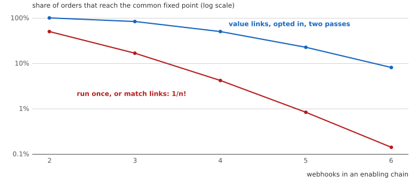

# Part 5: The Second Pass Is the Last

Companion to [The Second Pass Is the Last](https://e-mindset.space/blog/correct-in-isolation-part5-the-second-pass-is-the-last/).
The post states the argument; this page shows where each number comes from and how to change the inputs.
Layer tags follow the series: **Bound** (proof or source), **Fit** (reading or approximation), **Estimate**
(simulation).

## The question

When mutating admission webhooks that are each idempotent edit one object in an order nobody promises, which
compositions does the reinvocation contract's second pass repair, which can no number of passes repair, and how can
an operator tell, from outside, whether an admitted object is one every webhook would leave alone?

## The belief

Every mutating webhook is idempotent, as the documentation requires, so admission produces the same object
whatever order the webhooks run in.

## The mechanism, as the code runs it

[`model/admission.py`](../model/admission.py) applies webhooks, each a pure function of a pod-like object, in a given
order over a given number of rounds. `admit_trace` follows the dispatcher: a webhook's match rules are tested against
the object at its turn in every round; in a later round a webhook is called only if it opted in (IfNeeded), was
called before, and the object changed after its last call; a webhook not called in round 0 is never called. Each call
is recorded as `(round, index, webhook, mutated)`, as the `mutation.webhook.admission.k8s.io/round_r_index_i` audit
annotation records it. `final_round_clean` reads that trail; `readmission_clean` admits the admitted object again.
`outcomes` runs every order. `chain` and `typed_chain` build enabling chains of value links and match links.

## The laws

- **Bound. Proposition 27.** For idempotent webhooks, commuting implies convergence within the contract, which implies
  a common fixed point; neither converse holds, and idempotence implies none of them (T15).
- **Bound. Proposition 28.** An order of a chain of value links needs one pass plus its inversions, the links whose
  dependent stands before its enabler, which are the order's descents; depth $d$ needs
  $d + 1$ in the worst order, so two passes cover depth one (T16; every order to depth 4 in the tests).
- **Bound. Proposition 29.** With every order equally likely, the share that converges within $P$ passes is
  $\sum_{j<P} A(n_c, j)/n_c!$, under the contract $(2^{n_c} - n_c)/n_c!$ (T16, closed form against enumeration).
- **Bound. Proposition 30.** A match link is never repaired; members up to the last match link must stand in chain
  order, and the share that converges at any number of passes is $1/(\eta + 1)!$ (T50, T51).
- **Bound. A policy changes nothing.** A mutating admission policy has the same reinvocation contract, with may in place of will
  (the API reference).
- **Bound. Proposition 34.** A clean last pass certifies every webhook that was called, and none its match rules
  skipped (T52).
- **Bound. Proposition 35.** A second admission of the admitted object changes it exactly when it is not a common
  fixed point (T52).

## The gap and the intervention

- **Estimate. A frontier in passes.** The share of orders that converge within P passes rises to all of them at
  P equal to the chain's length; at the contract's two it falls faster than exponentially (T102).
- **Bound. Proposition 33.** Iterating dry-run admission reaches a common fixed point within as many admissions
  as there are things the webhooks add. Run as it must, stopping on a dry run that returns the object unchanged and
  then creating it, it costs 4.24 admissions and 43.4 webhook calls at seven webhooks against 14.0 for one;
  conflicting writers have no fixed point and fool that stopping rule (`orchestrate` in
  [`model/admission.py`](../model/admission.py), T102).

## The results

Every claim, with its section, is in [CLAIMS.md](CLAIMS.md).

## The bill, and when the advice reverses

A signed pod admitted with a stale signature in one order of six. A pod admitted with its injection label and no sidecar in half of all orders, with a clean audit trail. A capability policy that holds or fails by the names of two configurations. At their default settings, Istio's injector missing the container Vault's injector adds whenever Vault's release name sorts after it. A Kyverno digest pin that pins Istio's proxy and leaves Linkerd's tag at the projects' default names. And a security mutation that keeps the default and loses, in every order, to any injector that opts in.

**When the advice reverses.** The advice of this post is to find every link and conflict in a chain and remove the ones the contract cannot repair. It reverses where an order dependency is deliberate, as for a final webhook meant to override every other on one field. There the dependency is a design, and the price is that it holds only while that webhook's configuration name keeps it last.

## What you can vary

`admit`, `admit_trace` and `outcomes` take any list of webhooks, any start object, the reinvocation policy and the
number of passes. A webhook is any function of the object; give it a `match` attribute, a predicate on the object, to
model an object selector or match conditions. `typed_chain` takes any sequence of `'value'` and `'match'` links. The
closed forms are in [`model/formulas.py`](../model/formulas.py): `passes_needed`, `converged_share`, `eulerian`,
`typed_chain_rounds`, `typed_chain_share`, `match_ceiling`. The assumptions are in [ASSUMPTIONS.md](ASSUMPTIONS.md).

*What the second pass buys and what a match link takes away. With every webhook opted in, two passes keep a chain of value links converging in a share of orders that falls slowly at first; when they run once only the order with every enabler first converges, one in n!. A chain of match links falls to that same curve at any number of passes, because a webhook skipped in the first pass is never called.*
