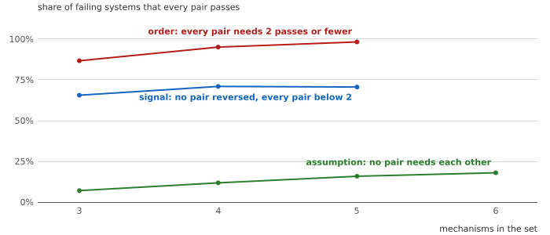

# Part 6: Every Pair Passes

Companion to [Every Pair Passes](https://e-mindset.space/blog/correct-in-isolation-part6-every-pair-passes/).
The post states the argument; this page shows where each number comes from and how to change the inputs.
Layer tags follow the series: **Bound** (proof or source), **Fit** (reading or approximation), **Estimate**
(simulation).

## The question

Every documented warning names two mechanisms, and every seam of Parts 1 to 5 was found between two. What does a
check of every pair miss, is there a test of the whole system for each seam, and what does that audit say about the
series' specimens?

## The belief

A system of correct parts is correct where the parts' pairwise warnings say nothing.

## The mechanism, as the code runs it

[`model/audit.py`](../model/audit.py) holds the whole-system tests: `relative_gains` of the full gain matrix,
`cyclic_components` of the start-time graph (Tarjan), and `config_order`, the order the API server derives from
configuration names. [`model/formulas_whole.py`](../model/formulas_whole.py) holds the constructions of
Proposition 36 (`symmetric_gain`, `singular_coupling`, `subset_gain`, `pair_gain_at_singular`, `spread_order`) and
`informers_to_bind`; [`model/formulas_order.py`](../model/formulas_order.py) holds `fact_passes`, checked against
`fact_webhooks` in [`model/admission.py`](../model/admission.py).

Four modules carry the rest of the post. [`model/interaction.py`](../model/interaction.py) computes the order of each
seam (Proposition 38). [`model/ratios.py`](../model/ratios.py) computes the seam ratios of Definition 21, the
assumption's as the spectral radius of the start-time graph, bracketed by Collatz and Wielandt.
[`model/incomplete.py`](../model/incomplete.py) drops parts of a description for Proposition 40, and
[`model/supervisor_whole.py`](../model/supervisor_whole.py) compares a supervisor that fixes seams by ratio with one
that reads the couplings. [`audit/seam_audit.py`](../audit/seam_audit.py) runs the five tests on a real cluster's
objects.

## The laws

- **Bound. Proposition 36.** For a shared signal, assumption and order, every $n \ge 3$ has a set of $n$ mechanisms
  whose every proper subset passes while the whole fails; $n$ symmetric loops are singular at $-1/(n-1)$, where a pair
  shows $1/(1-\alpha^2)$ and $n-1$ loops $2(n-1)/n$ (T17, T53).
- **Bound. No subset check certifies the whole.** No $t$-wise check certifies the whole for these seams (from Proposition 36).
- **Bound. Proposition 37.** In a given order, admission needs one plus the most inversions along any path of facts
  (T54 against simulation; T55 and T56 for the specimen and a pair).
- **Bound. Proposition 38.** A seam's order, its smallest failing set: a principal minor that is not positive (the
  integrity condition of Campo and Morari), the girth of the start-time graph, the closure of a fact of high rank, the
  fewest heaviest informers past $\kappa(\bar T + T_h)$ (T111).
- **Bound. Proposition 39.** Each whole-system test is polynomial and covers every subset for the assumption, order and
  state; for the signal it covers the whole only, and deciding that no subset fails is co-NP-complete (Coxson); T111
  also holds three loops that pass together while every pair fails.
- **Bound. Proposition 40.** A description that omits needs, prerequisites or informers can only hide a failure; an
  omitted coupling moves the signal's verdict either way (T115).
- **Bound. Proposition 41.** On a shared CPU metric, with four or more replicas, every resting setting needs at least
  $\lceil \ln(k u_r)/\ln 2 \rceil$ rounds for a $k$-fold surge (T109).
- **Estimate. Definitions 20 to 22.** The test region, the seam ratio and the cross-seam region: the specimens' ratios
  and a test at a tenth of the scale (T112), the assumption by order frontier (T116), and the frontier of the signal
  and time-scale fixes (T109).

## The gap and the intervention

- **Fit. The binding constraint moves with scale.** Each seam has its own scale variable and transition, drawn
  from Parts 1 to 5 (T90, T94, T98, T100, T102); read as ratios, only the shared state's grows with the nodes (T112).
- **Fit. The controllers are mechanisms too.** A controller that reads what a mechanism writes and sets what it reads shares state
  with it both ways; each of the series' controllers failed where its model was incomplete (T91, T96, T99,
  T101), as Conant and Ashby's good-regulator theorem predicts.
- **Estimate. A supervisor for the whole.** Fixing seams one at a time in order of their ratios reopens the first seam
  and ends four times slower on a surge than a supervisor that reads the couplings (T117).

## The results

Every claim, with its section, is in [CLAIMS.md](CLAIMS.md).

## The bill, and when the advice reverses

Six loops singular at a coupling where every pair reads 1.0417. A cluster whose configuration names alone admit a stale signature. In random systems, failing webhook orders that every pair passes 86 to 98% of the time, and reversed loops that no pair shows at all. And a fix of the signal seam through the horizontal target that makes the surge three and a half to six and a half times slower, where a fix through the metric repairs both seams. A supervisor that fixes seams in ratio order, holding 348 free slots for a 1,470-second surge. And a description missing a fifth of its needs, which shows 265 stranded components where 567 are.

**When the advice reverses.** The advice of this post is to replace pairwise review with whole-system tests where they exist. It reverses for a seam that has no known form, where enumerating combinations of mechanisms up to some order is the only test available. There the testing literature's evidence on how many conditions failures need is the best guide to which order to stop at.

## What you can vary

`symmetric_gain` takes any size and coupling, and `relative_gains` any square matrix. `fact_passes` takes any order
and any map of facts to their writer and prerequisites; `fact_webhooks` builds the matching webhooks for `admit`.
`config_order` takes any map of configuration names to webhook lists. The assumptions are in
[ASSUMPTIONS.md](ASSUMPTIONS.md).

*How often a failure is one no pair shows, in random systems. Failing webhook orders almost always pass every pairwise check, because a chain of depth two needs three webhooks. Reversed loops never show a reversal in any pair, and most read close to independent. Start-time cycles are the most forgiving: most contain two components that need each other, which a pairwise check finds.*
